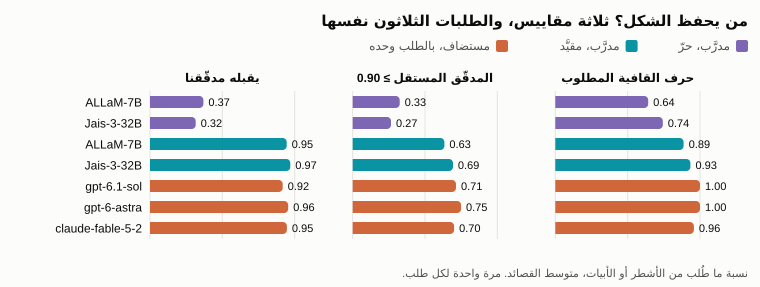
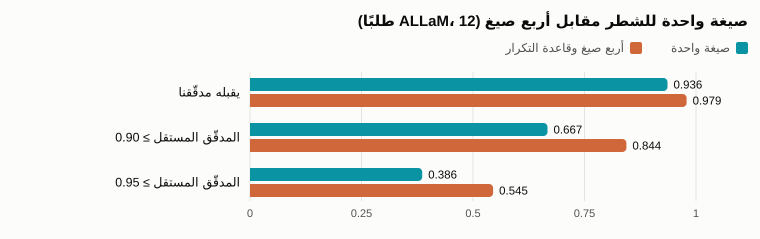
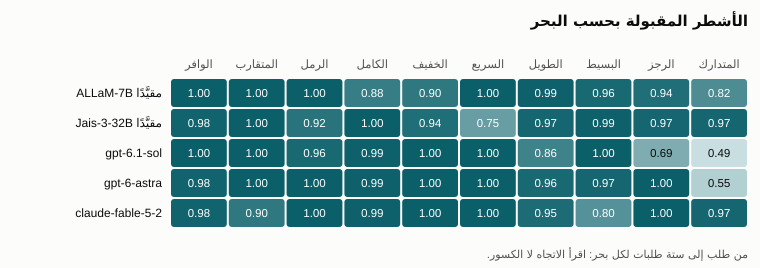
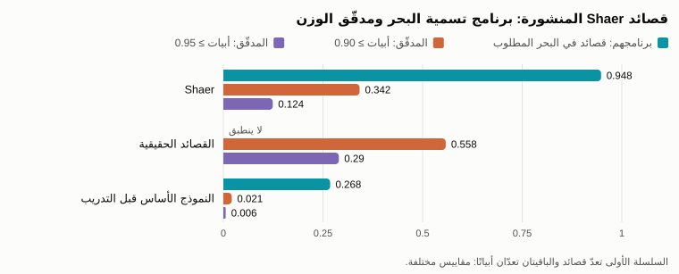
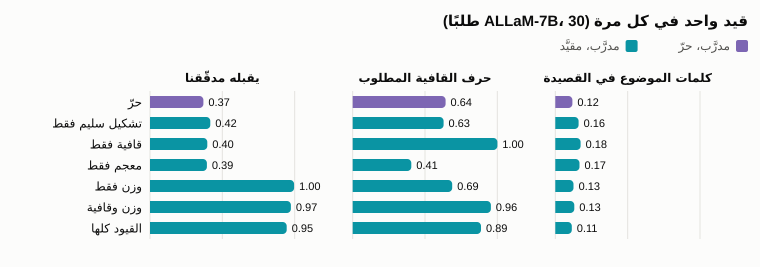
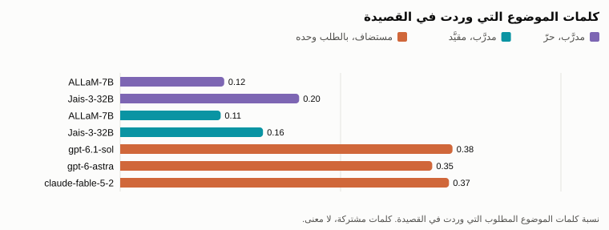
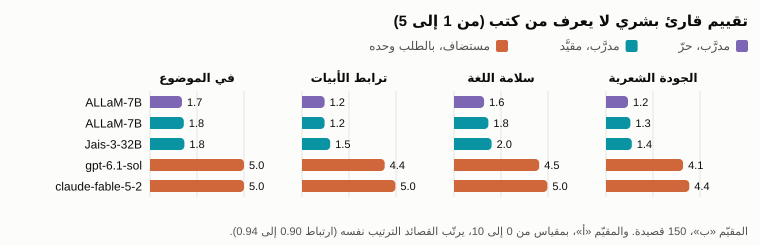
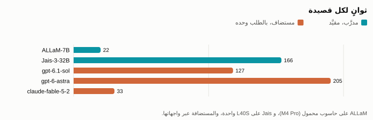

# شكلٌ بلا معنى

### ما الذي يضمنه القيد، وما الذي يعجز عنه، والمسافة بين قبول المدقّق وجودة النص

كريم عادل، 13 نوفمبر 2026.

النسخة الإنجليزية: [PAPER.md](PAPER.md). وشرحٌ في صفحة واحدة: [SUMMARY.ar.md](SUMMARY.ar.md).

الحمد لله الذي علّم بالقلم، علّم الإنسان ما لم يعلم.

## الخلاصة

في خريف عام 2026 ألزمنا نموذجًا لغويًّا بالوزن والقافية، وتركنا له المعنى. وأردنا أن نعرف: ماذا
يضمن القيد، وماذا لا يضمن؟

كتبنا برنامجًا يعرف صور كل بحر، يراقب النموذج وهو يكتب، فكلما همّ بكلمة تكسر البحر مَنَعَهُ
منها. ودرّبنا نموذجين على شعر كُتبت حركاته كلها، من فتحة وضمة وكسرة وسكون، وهو ما نسمّيه
التشكيل. الأول ALLaM-7B، والثاني Jais-3-32B وهو أكبر منه نحو خمس مرات. وجرّبناهما بثلاثين
طلبًا في عشرة بحور. فخرجنا بثلاثة.

**القيد يضمن ما كُتب فيه، لا أكثر.** شغّلنا القيود واحدًا واحدًا، فإذا كل قيد لا يحرّك إلا مقياسه.
قيد الوزن يرفع ما يقبله مدقّقنا من الأشطر من 37% إلى ما فوق 95%. وقيد القافية يضبط حرف القافية.
والمعجم يمنع الكلمة التي لم يقلها شاعر.

**ولا يبلغ ما يحكم به القارئ.** أعطينا قارئَين مئة وخمسين قصيدة وهما لا يعرفان من كتبها. فأعطيا
النموذج المقيَّد في الموضوع والترابط واللغة ما أعطياه وهو حرّ: في الموضوع 1.8 من 5 مقابل 1.7.
وعددنا كلمات الموضوع في القصائد فوجدناها سواء. والنموذج الأكبر مثله. فلم نجد للقيد أثرًا في
لزوم الموضوع، لا نفعًا ولا ضرًّا. ولا نقول إننا عرفنا علّة ضعفه.

**وقبول المدقّق ليس جودة النص، وقد لا يكون حتى صحة الوزن.** مدقّقنا يقبل 95% من أشطر النموذج
المقيَّد، والقارئان أنفسهما أعطياه في الوزن 2.5 من 10 و2.8 من 5. وفي القصائد التي نشرها أصحاب
نظام Shaer: برنامجهم يضع 94.8% منها في البحر المطلوب، ومدقّق الوزن لا يقبل إلا 34.2% من أبياتها،
وهو نفسه لا يقبل من الشعر الحقيقي إلا 55.8%.

ثم أرسلنا الطلبات نفسها إلى ثلاثة نماذج عامة مستضافة، بلا قيد ولا برنامج يراقبها:
gpt-6.1-sol و gpt-6-astra و claude-fable-5-2. فقَبِلَ مدقّقنا من أشطرها بين 92% و96%، وهو مدى
نموذجنا المقيَّد. وأعطاها القارئان في الموضوع 5 من 5. فالتساوي عند مدقّق ليس تساويًا في الشعر،
ولا ندّعيه.

وحدود هذا كله: القارئان ليسا من أهل الاختصاص، ولم يراجع عروضي مدقّقنا. والطلبات ثلاثون: ثلاث
محاولات لنموذج الـ7B، ومحاولة واحدة لغيره. والنماذج المستضافة مغلقة، سُئلت في يوم واحد.

## 1. الظنّ الذي بدأنا به

بيت الشعر العربي شطران: صدر وعجز. كل منهما على صورة من صور بحره، والقصيدة تلتزم حرفًا واحدًا
في آخر أبياتها، هو حرف القافية، ويسمّيه أهل العروض الرويّ.

والوزن تتابعُ حروف متحركة وساكنة. ولا يُعرف المتحرك من الساكن إلا بالحركات، ونحن لا نكتبها في
العادة. فإذا كتب النموذج بلا تشكيل، لم نستطع أن نزن كلامه حتى نشكّله ببرنامج آخر، فيدخل علينا
خطأ ثانٍ فوق الأول.

وكنا من قبل درّبنا ALLaM-7B على قصائد قديمة. فتعلّم شكل القصيدة وطولها وقافيتها، وبقي أكثر
أبياته مكسورًا.

فظننا أن الوزن هو العقبة. وقلنا: نجعله يكتب الحركات كلها، ثم نمنعه من الخروج عن البحر وهو
يكتب. فإن كان الظنّ صحيحًا، ظهر الشاعر.

ولم نكن أول من فكّر في هذا. صُنع مثله للإنجليزية في نظام Hafez عام 2016. وصُنع للسنسكريتية في
Chandomitra، وأصحابه يذكرون أن 99.86% مما خرج موزون، وأن القرّاء أعطوه في تماسك المعنى 2.1،
وأعطوا النموذج الحر 3.8. وكان في هذا الرقم الأخير نذير لم نلتفت إليه.

وأما العربية، ففي عام 2026 نشر Alkhalaileh و AlMazaedh مراجعة شاملة لخمس وأربعين دراسة بين
2020 و2025. وخلاصتهما هي التي سننتهي إليها: الشكل سبق المعنى بمسافة بعيدة، والقصائد المولَّدة
مقبولة الشكل ضحلة المعنى، وتكبير النموذج وحده لا يسدّ الفجوة. ويفرّقان بين كلام كلماته متصلة
وكلام فكرته متصلة، وعلى هذا الفرق تدور قراءتنا. ولم نجد نظامًا عربيًّا يمنع الكلمة المخالفة
للوزن وهو يكتب، ولا أزعم أننا الأوائل؛ وتفصيل ذلك في الملحق.

## 2. ماذا صنعنا

**القصائد.** أخذنا من ويكي مصدر العربية قصائد شعراء توفوا عام 1975 أو قبله: 40,043 قصيدة لـ296
شاعرًا. شكّلناها ببرنامج CATT، وأبقينا تشكيل الأصل حيث وُجد، ثم وزنّا كل بيت على بحر قصيدته،
واحتفظنا بما صحّ وزنه أو قارب. فبقي للتدريب 9,492 قصيدة فيها 76,318 بيتًا. ولكل قصيدة طلب
يصفها: موضوعها وبحرها وحرف قافيتها وعدد أبياتها ونبرتها.

وفي هذه المادة عيبان. الأول أن وصف الموضوع كتبه نموذج لغوي ولم يراجعه إنسان. احفظ هذا، فسنعود
إليه. والثاني أن 8% من الأشطر فيها تنوين مكرر (`ًاً`) تركه برنامج التشكيل، فتعلّمه النموذجان
وكتباه.

**النموذجان.** ALLaM-7B درّبناه على Kaggle في أربع ساعات ونصف تقريبًا. و Jais-3-32B، وفيه
34.9 مليار معامل، درّبناه على خادم مستأجر في المدة نفسها تقريبًا. وتفاصيل التدريب في الملحق.

**المدقّق الذي يراقب الكتابة.** النموذج يقترح الكلمة التالية، والمدقّق ينظر في أرجح أربعين
اقتراحًا، فيُسقط منها ثلاثة أنواع:

1. ما يكسر البحر: أي ما يجعل الشطر عاجزًا عن أن يكتمل على صورة من صور بحره.
2. ما ليس من كلام الشعراء: عندنا معجم من 73,278 كلمة وردت في القصائد مرتين على الأقل، فما خرج
   عنه رُدّ.
3. ما يُفسد التشكيل: حركتان على حرف، أو تنوين في وسط الكلمة، وما أشبه.

ثم يختار النموذج مما بقي. والعجز لا يُقبل حتى ينتهي بحرف القافية المطلوب، بكلمة قافية لم تتكرر.
فإن لم يبقَ اقتراح واحد يصلح، أعاد الشطر من أوله، إلى ست مرات. فإن عجز بعدها كتب مكانه «…»
وعدّه علينا، ولم يُخفِه.

**كيف قسنا.** بمدقّقَين لا بواحد. والفرق بينهما سيظهر أثره:

- **مدقّقنا** يقرأ الشطر بالتشكيل الذي كتبه النموذج نفسه. فهو يصدّقه في تشكيله.
- **المدقّق المستقل** لا يصدّقه. يمحو تشكيله، ويشكّل الكلام من جديد ببرنامج CATT، ثم يزنه ببرنامج
  pyarud، فيعطي البيت درجة من واحد. ونعدّ البيت موزونًا إذا بلغ 0.90، ونذكر كذلك حدًّا أشدّ هو
  0.95.

وللمدقّق المستقل عيوبه. جرّبناه قديمًا فقَبِلَ 63% فقط من أبيات حقيقية، وقَبِلَ مع ذلك 20 إلى 28%
من أبيات أفسدنا فيها كلمة عمدًا. فلا تأخذ أرقامه على أنها الحق كله.

والاختبار ثلاثون طلبًا في عشرة بحور، فيها 188 بيتًا مطلوبًا، و24 طلبًا منها تسمّي حرف القافية.

## 3. ماذا وجدنا

| من كتب (30 طلبًا) | يقبله مدقّقنا | المستقل ≥ 0.90 | المستقل ≥ 0.95 | حرف القافية المطلوب | أشطر لم تكتمل، لكل قصيدة | أشطر منقولة |
|---|---|---|---|---|---|---|
| ALLaM-7B حرًّا | 0.369 | 0.325 | 0.125 | 0.642 | 0.00 | 0 من 376 |
| ALLaM-7B مقيَّدًا، بالمدقّق في صورته الأولى | 0.861 | 0.620 | 0.405 | 0.931 | 0.50 | 0 من 361 |
| ALLaM-7B مقيَّدًا، بالمدقّق في صورته الأخيرة | 0.945 | 0.634 | 0.391 | 0.887 | 0.67 | 0 من 356 |
| Jais-3-32B حرًّا | 0.316 | 0.265 | 0.094 | 0.743 | 0.03 | 0 من 375 |
| Jais-3-32B مقيَّدًا، بالمدقّق في صورته الأولى | 0.821 | 0.607 | 0.323 | 0.920 | 0.43 | 0 من 363 |
| Jais-3-32B مقيَّدًا، بالمدقّق في صورته الأخيرة | 0.970 | 0.693 | 0.369 | 0.934 | 0.37 | 0 من 365 |
| gpt-6.1-sol بالطلب وحده | 0.917 | 0.714 | 0.406 | 1.000 | 0.00 | 0 من 376 |
| gpt-6-astra بالطلب وحده | 0.955 | 0.749 | 0.407 | 1.000 | 0.00 | 0 من 376 |
| claude-fable-5-2 بالطلب وحده | 0.946 | 0.701 | 0.460 | 0.958 | 0.00 | 0 من 368 |

كلمة عن الجدول قبل قراءته. شدّدنا قواعد المدقّق في أثناء العمل، فصار يردّ تشكيلًا فاسدًا كان
يقبله. والقصائد التي كُتبت بصورته الأولى كانت تنال عنده يومها 0.961 و0.960، فلما عرضناها على
صورته الأخيرة نزلت إلى ما تراه. وقد حاكمنا الجميع إلى الصورة الأخيرة، ليكون الحكم واحدًا. ثم
أعدنا كتابة قصائد النموذجين بها، فذلك صفّا «الصورة الأخيرة». والعمود الأخير جواب سؤال: هل نقل أحدهم شطرًا من القصائد التي
عندنا؟ لا، ولا شطرًا واحدًا.

**كم نثق بهذه الأرقام؟** أعدنا سحب الطلبات الثلاثين عشرة آلاف مرة، وحسبنا لكل رقم المدى الذي يقع
فيه 95% من النتائج. وهذا المدى يصف اختلاف هذه الطلبات فيما بينها، لا اختلاف طلبات أخرى ولا
اختلاف المحاولات.

| | يقبله مدقّقنا | المستقل ≥ 0.90 | حرف القافية |
|---|---|---|---|
| ALLaM-7B حرًّا | 0.369 [0.298، 0.437] | 0.325 [0.244، 0.411] | 0.642 [0.490، 0.790] |
| ALLaM-7B مقيَّدًا | 0.945 [0.903، 0.976] | 0.634 [0.550، 0.715] | 0.887 [0.783، 0.967] |
| gpt-6.1-sol | 0.917 [0.836، 0.982] | 0.714 [0.625، 0.801] | 1.000 |
| gpt-6-astra | 0.955 [0.891، 0.994] | 0.749 [0.661، 0.826] | 1.000 |
| claude-fable-5-2 | 0.946 [0.872، 0.988] | 0.701 [0.624، 0.772] | 0.958 [0.875، 1.000] |
| الفرق: المقيَّد ناقص الحر (ALLaM) | +0.576 [0.507، 0.645] | +0.309 [0.201، 0.413] | +0.245 [0.054، 0.425] |
| الفرق: gpt-6.1-sol ناقص ALLaM المقيَّد | -0.027 [-0.113، 0.047] | +0.080 [-0.025، 0.182] | +0.113 [0.033، 0.217] |
| الفرق: claude-fable-5-2 ناقص ALLaM المقيَّد | +0.001 [-0.090، 0.070] | +0.066 [-0.054، 0.180] | +0.071 [-0.059، 0.201] |
| الفرق: claude-fable-5-2 ناقص gpt-6.1-sol | +0.028 [-0.076، 0.126] | -0.014 [-0.129، 0.099] | -0.042 [-0.125، 0.000] |

فأثر القيد ثابت في المقاييس الثلاثة: مداه كله فوق الصفر. وأما بين نموذجنا المقيَّد والنموذجين
المستضافين، فلا فرق ثابت في قبول الوزن ولا عند المدقّق المستقل: المدى يشمل الصفر. والفرق الثابت
الوحيد سبقُ gpt-6.1-sol في حرف القافية.

**أولًا: استقام الوزن.** انظر إلى ALLaM: من 0.369 إلى 0.945 عند مدقّقنا، ومن 0.642 إلى 0.887 في
حرف القافية. والمدقّق المستقل أقل حماسة، من 0.325 إلى 0.634. لماذا؟ لأن النموذج يضع أحيانًا حركات لا
يضعها قارئ على الكلمة نفسها، ومدقّقنا يصدّقه.

**ثانيًا: وغاب المعنى.** هذه قراءتي، وقياس القرّاء يأتي في «عاشرًا». والذي قرأته في القصائد المقيَّدة:
كلمات صحيحة من معجم القدماء، قلّما تجتمع في جملة تقول شيئًا عن الموضوع.

وقد ظننا أول الأمر أن العلة في الكلمات المخترعة. كان 10.3% من الكلمات خارج معجم القصائد حين
قيّدنا الوزن وحده. فأضفنا المعجم، فلم تبقَ كلمة مخترعة. وبقيت القصائد الخمس التي قارنّاها على
حالها.

**ثالثًا: نموذج أكبر: لغة أسلم، والموضوع غائب كما هو.** Jais أكبر من ALLaM نحو خمس مرات. وليس خيرًا منه في
الوزن حرًّا (0.316 مقابل 0.369). وأما مقيَّدًا بالمدقّق في صورته الأخيرة فأرقامه أعلى بقليل: 0.970
مقابل 0.945 عند مدقّقنا، و0.693 مقابل 0.634 عند المستقل، ويترك أشطرًا أقل بلا إكمال. وليس في
ذلك فرق ثابت: الفرق عند مدقّقنا 0.025 [-0.016، 0.074]. ويكتب القصيدة في 166 ثانية على خادم،
وصاحبه يكتبها في 21.5 على حاسوب محمول. وكلمات الموضوع عنده 0.162، وعند صاحبه 0.114، وعند
النماذج المستضافة بين 0.35 و0.38. جمله داخل
الشطر أسلم، وتكراره أقل. وقليل من كلامه يتصل بالموضوع، كصاحبه. وأحترز: ليست هذه مقارنة مضبوطة
للحجم، فالنموذجان من أصلين مختلفين، وتدريبهما مختلف.

وجرّبنا نموذجًا ثالثًا لم ندرّبه على الشعر أصلًا، Qwen3-30B، في ثلاثة طلبات. فترك في المتوسط
عشرة أشطر من كل قصيدة بلا إكمال. فالقيد يمنع الخطأ، ولا يُلهم الصواب.

**رابعًا: النموذج يحتال.** وهذا عندي ألطف ما في التجربة. ما وضعنا قاعدة إلا وجد النموذج بابًا
يدخل منه وهو ملتزم بها حرفًا:

1. اخترع كلمات توافق الوزن. فأغلقنا الباب بالمعجم.
2. فكتب حرفًا واحدًا وعدّه كلمة، أو «الـ» وحدها. فأغلقناه.
3. فمدّ الكلمة بالتطويل (ـ) لتبدو أطول ولا يتغير وزنها. فأغلقناه.
4. فوضع مسافة في وسط الكلمة، فصار كل نصف منها كلمة معروفة: `أَعْمُرَّ هَا`. وهذا الباب ما زال
   مفتوحًا.
5. فركّب الحركات فوق بعضها: `وَدَّْاِّعِ`. فأغلقناه، ودفعنا الثمن: زادت الأشطر التي لا تكتمل
   من 0.50 إلى 0.67 في القصيدة.
6. واختار حركة الإعراب التي تناسب الوزن لا التي يطلبها النحو. مفتوح، وأدواتنا لا تكشف هذا الخطأ.
7. وفي البحور القصيرة، كالرمل والمتدارك، قسم الكلمات بين الصدر والعجز حتى صار الكلام لا يُقرأ.
   واتصال الكلمة بين الشطرين جائز عند الشعراء، ويسمّونه التدوير، لكنه عندهم نادر. مفتوح.
8. وقبِل المدقّق «رَاعِيًا» قافيةً على العين، وحرف القافية فيها الياء. فأغلقناه.
9. وجاء بكلمة قافية لا عمل لها في البيت إلا حرفها الأخير. مفتوح.

وانظر إلى البابين السادس والتاسع. ليسا من أخطاء الشكل. لا تراهما قاعدة، ويراهما كل قارئ.

**خامسًا: أربع محاولات خير من واحدة.** جعلنا النموذج يكتب للشطر الواحد أربع صيغ صحيحة الوزن،
ثم نُبقي الصيغة التي احتاجت إلى أقل منع. فماذا فعل؟ كرّر نفسه: صدر واحد عاد ثماني مرات في
قصيدة من ثمانية أبيات. فأضفنا قاعدة تؤخّر الصيغة إذا كان أكثر من نصف كلماتها قد ورد في شطر
سابق.

| ALLaM، 12 طلبًا | صيغة واحدة | أربع صيغ وقاعدة التكرار |
|---|---|---|
| يقبله مدقّقنا | 0.936 | 0.979 |
| المستقل ≥ 0.90 | 0.667 | 0.844 |
| المستقل ≥ 0.95 | 0.386 | 0.545 |
| أشطر لم تكتمل، لكل قصيدة | 0.67 | 0.17 |
| ثوانٍ لكل قصيدة | 23 | 56 |

فالشكل تحسّن. وفي القصائد الثلاث التي قرأتها من هذه التجربة لم يتحسن الكلام في الموضوع. وهي
اثنا عشر طلبًا فقط، فلا أقطع بمقدار التحسن.

**سادسًا: أعطيناه خطة الشعراء، فلم يلتفت إليها.** يقول ابن طباطبا العلوي في «عيار الشعر» إن
الشاعر يُحضر المعنى في فكره نثرًا قبل أن ينظمه. ويقول ابن رشيق القيرواني في «العمدة» ما معناه
أن الشاعر لا يصنع بيتًا لا يعرف قافيته.

فقلنا: نعطي النموذج خطة كما يفعل الشعراء. لكل بيت كلمة قافيته وكلمتان من معناه، أخذناها من قصائد
حقيقية، وألزمناه أن يختم كل بيت بكلمته. وجرّبنا ذلك في ثماني قصائد قصيرة.

فلم يُتمّ عجزًا واحدًا.

كل محاولة انتهت بغير الكلمة المطلوبة فردّها المدقّق، وخرجت الأعجاز كلها «…»، 4.1 في القصيدة. ولم
يستعمل من كلمات الخطة كلمة.

والنموذج لم يرَ خطة قط في تدريبه، فلا عجب. وقد بنينا مادة تدريب فيها الخطط (9,485 قصيدة)
ونشرنا برنامجها، ولم ندرّب عليها نموذجًا بعد. فهل ينفع التدريب على الخطط؟ لا أدري.

**سابعًا: ثم سألنا نموذجًا لم نقيّده بشيء.** في 13 نوفمبر 2026 أرسلنا الطلبات الثلاثين كما هي
إلى النموذج gpt-6.1-sol، مرة واحدة لكل طلب، بلا مدقّق يراقبه. ولم نحذف مما ردّ به شيئًا ولم
نُعِد.

فقَبِلَ مدقّقنا 0.917 من أشطره، والمدقّق المستقل 0.714 من أبياته، وأصاب حرف القافية في الأبيات كلها.
أي أنه عند مدقّقنا في مدى ما بلغناه نحن بالقيد.

وهو في البسيط والكامل والخفيف والمتقارب والرمل والسريع والوافر بين 0.96 و1.00، وفي الطويل
0.86، وفي الرجز 0.69، وفي المتدارك 0.49. واثنتان من عثراته ليستا مما تعرفه جداولنا: قصيدة من
الطويل قافيتها ساكنة («الدَّارْ»)، وقصيدة من المتدارك تنتهي أشطرها كلها بساكن. ولم نسأل
عروضيًّا: أهذا جائز أم خطأ؟

وسألنا كذلك أخاه الأكبر من الشركة نفسها، gpt-6-astra. فقَبِلَ مدقّقنا 0.955 من أشطره، والمدقّق
المستقل 0.749 من أبياته، وأصاب حرف القافية في الأبيات كلها، ولم ينقل شطرًا. وكتب القصيدة في نحو
205 ثوانٍ. وصنع في قصيدة المتدارك ما صنعه أخوه: ختم أشطرها كلها بساكن، فردّها مدقّقنا. ونموذجان
يتفقان على الاختيار نفسه قرينةٌ على أن العيب قد يكون في جداولنا لا فيهما.

ولئلا يكون الحكم على نموذج واحد، سألنا في اليوم نفسه نموذجًا ثانيًا من شركة أخرى،
claude-fable-5-2، بالطلبات نفسها وبالشروط نفسها. فقَبِلَ مدقّقنا 0.946 من أشطره، والمدقّق المستقل
0.701 من أبياته (و0.460 عند الحدّ الأشدّ)، وأصاب حرف القافية في 0.958 من الأبيات. وكتب القصيدة في
نحو 33 ثانية.

وله عثرة لا أخفيها: كتب قصيدة واحدة وترك سطرًا فارغًا بعد كل شطر لا بعد كل بيت، فلم يجد برنامجنا
فيها بيتًا، ونالت صفرًا كما كُتبت. ولو قُرئت أشطرها مثنى مثنى لقُبلت كلها، ولصار رقمه 0.979 في
الوزن و1.000 في القافية. وقد أثبتنا الرقم كما كُتب.

والنماذج الثلاثة متقاربة. فليس ما رأيناه خاصًّا بنموذج شركة بعينها.

وهنا ثلاثة تحفظات. هذا نموذج مغلق لا نعرف حجمه ولا ما تدرّب عليه، وسيتغير غدًا، فالرقم
مشاهدة يوم واحد. ونحن لم نبحث عن أشطره إلا في قصائدنا، لا في شعر العرب كله. ولغته حديثة
سهلة، ليست لغة القدماء.

**ثامنًا: وماذا عن أرقام غيرنا؟** نظام Shaer منشور في مؤتمر ArabicNLP لعام 2026، وأصحابه
يذكرون أن 95.2% من قصائده في البحر المطلوب. فمن الذي يشهد بذلك؟ برنامج يسمّي البحر: تعطيه
القصيدة فيقول «هذه من الطويل».

لم نستطع تشغيل النظام نفسه لأن نموذجه الأساس محجوب عنا. لكن أصحابه نشروا قصائده الـ3,481،
ومعها القصائد الحقيقية التي قيست عليها. فأخذنا خمسمئة منها بالقرعة، فيها 2,813 بيتًا، وعرضناها
على المدقّق المستقل.

| | Shaer | القصائد الحقيقية | النموذج الأساس قبل التدريب |
|---|---|---|---|
| برنامجهم: القصيدة في البحر المطلوب | 94.8% | لا ينطبق | 26.8% |
| المدقّق المستقل: أبيات ≥ 0.90 | 34.2% | 55.8% | 2.1% |
| المدقّق المستقل: أبيات ≥ 0.95 | 12.4% | 29.0% | 0.6% |
| أبيات تنتهي بالحرف الغالب في أواخر القصيدة | 76.2% | 94.5% | 61.6% |

فانظر إلى السطرين الأولين، ولا تُنقِص أحدهما من الآخر: الأول يعدّ قصائد والثاني يعدّ أبياتًا.
الذي يقوله الجدول أن برنامجًا قد يسمّي البحر صحيحًا في 94.8% من القصائد، والمدقّق لا يقبل من
أبياتها إلا 34.2%، وهو يقبل من الشعر الحقيقي 55.8%. فتسمية البحر شيء، وصحة الوزن شيء.

وانظر كذلك إلى عيب المدقّق المستقل في الجدول نفسه: ردّ 44% من أبيات قصائد حقيقية. فأرقامه
نِسَب قبول عنده، لا مقدار الشعر الصحيح في الدنيا. وطلبات Shaer غير طلباتنا، فليس هذا الجدول
مقارنة بينه وبين ما في الجدول الأول.

**تاسعًا: أيّ قيد صنع ماذا؟** سألنا سائل: أضعفُ المعنى من قيد الوزن، أم من المعجم القديم، أم من شيء
كان قبل القيود كلها؟ فشغّلنا القيود على ALLaM واحدًا واحدًا، بالطلبات الثلاثين نفسها. وأضفنا
مقياسًا لا يحتاج إلى قارئ: نسبة كلمات الموضوع المطلوب التي وردت في القصيدة. وهو يرى الكلمات
المشتركة لا المعنى، وقد تكون القصيدة في موضوعها ولا تكرر كلماته.

| ALLaM-7B | يقبله مدقّقنا | المستقل ≥ 0.90 | حرف القافية | أشطر لم تكتمل، لكل قصيدة | كلمات الموضوع |
|---|---|---|---|---|---|
| حرّ | 0.369 | 0.325 | 0.642 | 0.00 | 0.118 |
| تشكيل سليم فقط | 0.417 | 0.394 | 0.628 | 0.00 | 0.161 |
| قافية فقط | 0.396 | 0.401 | 1.000 | 0.00 | 0.175 |
| معجم فقط | 0.393 | 0.386 | 0.405 | 0.00 | 0.167 |
| وزن فقط | 0.996 | 0.680 | 0.688 | 0.03 | 0.126 |
| وزن وقافية | 0.974 | 0.635 | 0.955 | 0.33 | 0.131 |
| القيود كلها | 0.945 | 0.634 | 0.887 | 0.67 | 0.114 |

فانظر. كل قيد يحرّك مقياسه هو، ولا يكاد يمسّ غيره. الوزن وحده يبلغ 0.996 ولا يكاد يترك شطرًا بلا
إكمال؛ والأشطر الناقصة تأتي حين نضيف القافية (0.33 في القصيدة) ثم المعجم (0.67).

وانظر إلى العمود الأخير. كلمات الموضوع بين 0.11 و0.18 في الصفوف كلها. وفي الصف الأول أيضًا،
والنموذج فيه حرّ لا قيد عليه.

وأعدنا التجربة مرتين أخريين للحرّ وللمقيَّد فلم يتغير شيء: القبول 0.367 و0.375 حرًّا، و0.935
و0.945 مقيَّدًا. وكلمات الموضوع 0.212 و0.186 حرًّا، و0.196 و0.148 مقيَّدًا.

والمقياس نفسه يقسم الأنظمة فريقين: النماذج المستضافة الثلاثة بين 0.35 و0.38، ونماذجنا المدرَّبة
بين 0.11 و0.21، حرّةً كانت أو مقيَّدة.

فالنموذج المدرَّب كان قليل الكلام في موضوعه قبل أن نقيّده، وبقي كذلك بعده. لم نرَ للقيد أثرًا في ذلك.

هذا بمقياس الكلمات. والقرّاء قالوا مثله، كما سيأتي.

**عاشرًا: ماذا قال القرّاء؟** أعطينا قارئَين من البشر، ليسا من أهل الاختصاص في الشعر القديم ولا
في العروض، مئة وخمسين قصيدة: الطلبات الثلاثون عند خمسة أنظمة (ALLaM حرًّا، و ALLaM مقيَّدًا، و Jais
مقيَّدًا، و gpt-6.1-sol، و claude-fable-5-2؛ وأما gpt-6-astra فأُضيف بعد إرسال الورقة فلم يُقيَّم).
وفي الورقة لكل قصيدة رمز وطلبها، بترتيب عشوائي، بلا اسم نظام. المقيّم «ب» التزم مقياس الورقة من
1 إلى 5، والمقيّم «أ» استعمل مقياسًا من 0 إلى 10، فأثبتناه كما هو. والدرجات، بلا ملاحظات
المقيّمَين، في `paper/data/human_ratings/`.

| | في الموضوع | ترابط الأبيات | سلامة اللغة | الجودة الشعرية | الوزن | العام |
|---|---|---|---|---|---|---|
| **المقيّم «أ» (من 0 إلى 10)** | | | | | | |
| ALLaM-7B حرًّا | 2.5 | 1.5 | 1.3 | 1.3 | 2.4 | 1.8 |
| ALLaM-7B مقيَّدًا | 2.6 | 1.7 | 1.7 | 1.5 | 2.5 | 2.1 |
| Jais-3-32B مقيَّدًا | 3.0 | 2.0 | 1.8 | 1.8 | 2.9 | 2.4 |
| gpt-6.1-sol | 10.0 | 8.6 | 8.7 | 7.4 | 7.1 | 8.3 |
| claude-fable-5-2 | 9.9 | 8.9 | 8.7 | 7.5 | 7.5 | 8.4 |
| **المقيّم «ب» (من 1 إلى 5)** | | | | | | |
| ALLaM-7B حرًّا | 1.7 | 1.2 | 1.6 | 1.2 | 2.3 | 1.2 |
| ALLaM-7B مقيَّدًا | 1.8 | 1.2 | 1.8 | 1.3 | 2.8 | 1.2 |
| Jais-3-32B مقيَّدًا | 1.8 | 1.5 | 2.0 | 1.4 | 2.9 | 1.5 |
| gpt-6.1-sol | 5.0 | 4.4 | 4.5 | 4.1 | 4.9 | 4.2 |
| claude-fable-5-2 | 5.0 | 5.0 | 5.0 | 4.4 | 5.0 | 5.0 |

**هل اتفقا؟** في القصائد كلها يرتّبانها ترتيبًا متقاربًا جدًّا: الارتباط بين 0.90 و0.94 في كل بند.
لكن أكثر هذا الاتفاق سهل، فالفرق بين الفريقين يراه كل قارئ. وفي داخل الفريق يقلّ: بين 0.58 و0.79
في قصائد النماذج المدرَّبة، وبين 0.08 و0.71 في قصائد النماذج المستضافة. فهما متفقان على الجيد
والرديء، وأقل اتفاقًا على ترتيب الجيد.

**وماذا قالا؟**

- النماذج المستضافة فوق نماذجنا بمسافة بعيدة في الموضوع والترابط واللغة والجودة، عند المقيّمَين
  كليهما، والفرق ثابت في كل بند.
- والقيد لم يغيّر حكمهما على الموضوع ولا على الترابط. الفرق بين ALLaM مقيَّدًا وحرًّا في الموضوع:
  +0.03 من 10 عند «أ»، و+0.10 من 5 عند «ب»، وكلاهما غير ثابت. وهذا ما قاله مقياس الكلمات في «تاسعًا»:
  لم نرَ للقيد أثرًا في لزوم الموضوع، لا نفعًا ولا ضرًّا.
- والقارئان لا يسمعان الوزن الذي يقبله مدقّقنا. ALLaM المقيَّد، الذي يقبل مدقّقنا 0.945 من أشطره،
  نال في الوزن 2.5 من 10 و2.8 من 5. ورفع القيدُ درجة الوزن عند «ب» 0.47 [0.23، 0.70]، ولم يرفعها
  عند «أ». فإما أن مدقّقنا يقبل ما لا يستقيم في السمع، وإما أن القارئ غير العروضي يحكم على الوزن من
  المعنى. ولا نعرف أيّهما حتى ينظر عروضي، وهذا أقوى سبب لمراجعة المدقّق.
- وبين النموذجين المستضافين: «ب» يفضّل claude-fable-5-2 في التقدير العام (+0.80 من 5)، و«أ» لا يرى
  فرقًا ثابتًا.

**حادي عشر: قبل التدريب وبعده.** لنفرّق بين ما كان ينقص النموذج وما صنعه به تدريبنا، شغّلنا
ALLaM-7B الأصلي بلا تدريب على الطلبات الثلاثين نفسها، حرًّا.

| ALLaM-7B حرًّا | يقبله مدقّقنا | المستقل ≥ 0.90 | حرف القافية | كلمات الموضوع |
|---|---|---|---|---|
| قبل التدريب | 0.030 | 0.032 | 0.066 | 0.305 [0.194، 0.426] |
| بعد التدريب، المحاولة الأولى | 0.369 | 0.325 | 0.642 | 0.118 |
| بعد التدريب، المحاولة الثانية | 0.367 | 0.402 | 0.604 | 0.212 |
| بعد التدريب، المحاولة الثالثة | 0.375 | 0.321 | 0.365 | 0.186 |

فالتدريب هو الذي أعطى النموذج شكلًا: ارتفع ما يقبله المدقّق 0.34 [0.27، 0.41]، وكان قبله لا يكاد
يكتب شطرًا موزونًا.

وأما كلمات الموضوع فسارت في الاتجاه الآخر. النموذج بعد التدريب يذكر من كلمات الموضوع أقل مما كان
يذكر قبله، في المحاولات الثلاث: الفرق -0.19 [-0.30، -0.08]، و-0.09 [-0.24، 0.05]، و-0.12
[-0.25، 0.01]. ثابت في واحدة منها. ورقمه قبل التدريب، 0.31، قريب من النماذج المستضافة.

فهذا يوافق أن يكون لزوم الموضوع ضاع في التدريب، وأوصاف الموضوع في مادة التدريب كتبها نموذج ولم
تُراجَع، وقد قلت لك احفظه. ويوافق ولا يُثبت: المقياس مقياس كلمات، والمدى في محاولتين من ثلاث
يشمل الصفر، والتجربة الحاسمة، وهي تدريب بأوصاف مراجَعة، لم نُجرِها.

**ثاني عشر: طلبات لم يرها المدقّق.** كل ما سبق قيس على الطلبات الثلاثين التي كنا نكتب قواعد
المدقّق ونحن ننظر إليها. فلئلا تكون النتائج مفصَّلة عليها، ثبّتنا القواعد وسجّلنا بصمتها، ثم كتبنا
ثلاثين طلبًا جديدًا بالبحور والقوافي والأطوال نفسها وبموضوعات جديدة، وشغّلنا عليها كل نظام مرة
واحدة.

| الطلبات الجديدة | يقبله مدقّقنا | المستقل ≥ 0.90 | المستقل ≥ 0.95 | حرف القافية | أشطر لم تكتمل | كلمات الموضوع |
|---|---|---|---|---|---|---|
| ALLaM-7B قبل التدريب، حرًّا | 0.035 | 0.022 | 0.000 | 0.078 | 0.67 | 0.282 |
| ALLaM-7B مدرَّبًا، حرًّا | 0.384 | 0.364 | 0.129 | 0.592 | 0.00 | 0.164 |
| ALLaM-7B مدرَّبًا، مقيَّدًا | 0.975 | 0.619 | 0.374 | 0.946 | 0.30 | 0.214 |
| Jais-3-32B مدرَّبًا، حرًّا | 0.316 | 0.251 | 0.107 | 0.648 | 0.03 | 0.158 |
| Jais-3-32B مدرَّبًا، مقيَّدًا | 0.959 | 0.681 | 0.361 | 0.922 | 0.50 | 0.173 |
| gpt-6.1-sol بالطلب وحده | 0.891 | 0.644 | 0.417 | 1.000 | 0.00 | 0.409 |
| gpt-6-astra بالطلب وحده | 0.941 | 0.739 | 0.454 | 1.000 | 0.00 | 0.425 |
| claude-fable-5-2 بالطلب وحده | 0.895 | 0.655 | 0.423 | 0.958 | 0.00 | 0.393 |

فتكرر ما رأيناه في الطلبات الأولى.

- القيد رفع القبول 0.59 [0.52، 0.67]، وكان في الأولى 0.58. وترك كلمات الموضوع حيث هي: +0.05
  [-0.04، 0.14].
- والتدريب رفع القبول 0.35 [0.26، 0.44] فوق النموذج الأصلي، وأنزل كلمات الموضوع 0.12 [-0.24،
  0.00]. الاتجاه نفسه.
- والنماذج المستضافة تذكر من كلمات الموضوع نحو ضعف ما يذكره نموذجنا المقيَّد، والفرق ثابت. وليست
  فوقه عند المدقّق المستقل: لا فرق ثابت.
- وعند مدقّقنا صار نموذجنا المقيَّد هنا فوق اثنين من النماذج المستضافة بقليل (0.975 مقابل 0.891
  و0.895)، ومثل gpt-6-astra. وأكثر ذلك عند claude-fable-5-2 من هيئة الكتابة لا من الوزن: كتب
  قصيدتين بسطر فارغ بعد كل شطر، فنالتا صفرًا كما كُتبتا؛ ولو قُرئتا مثنى مثنى لقُبلتا كلتاهما، ولصار
  رقمه 0.962. وأضعف بحور النماذج المستضافة هي هي: المتدارك والرجز.
- و Jais، وهو أكبر خمس مرات، على الحال نفسها: رفع القيد قبوله 0.64 [0.58، 0.71]، وترك كلمات
  الموضوع حيث هي: +0.02 [-0.09، 0.13]. ولا فرق ثابت بينه وبين ALLaM مقيَّدَين في مقياس واحد. والنماذج
  المستضافة تذكر من كلمات الموضوع أكثر من ضعف ما يذكره، والفرق ثابت.
- ولم ينقل نظام شطرًا من القصائد التي عندنا.

وقصائد هذه المجموعة لم يقيّمها قارئ.

## 4. ثلاث قصائد

قرأتُ قصائد الجدول الأول كلها. وأنا قارئ واحد، أعرف مَن كتب كل قصيدة، ولم أسجّل درجات؛ فليست
قراءتي حكم خبير. والقصائد كلها منشورة في `paper/data/` لمن أراد أن يحكم بنفسه: مئتان وأربعون لصفوف الجدول الأول
الثمانية، ومعها قصائد تجربة القيود والمحاولات الإضافية.

طلبنا رثاءً للأم، من الكامل، على الدال. فقال ALLaM مقيَّدًا:

> يَا أُمُّ تَدْرِي بِالدُّمُوعِ فَأَنْتُمَا
> هَذِي الدُّمُوعُ وَكَيْفَ لَاً تَتَجَدَّدُ

ثم أعاد الصيغة نفسها ثمانية أبيات، لا يغيّر فيها إلا كلمة. (والتنوين المكرر في «لَاً» هو العيب
الذي ذكرته في مادة التدريب.) وقال Jais مقيَّدًا في الطلب نفسه:

> وَبَدَا بِهِ أَثَرُ الصَّبَابَةِ وَالنَّدَى
> لَمَّا تَوَافَى الْعَاشِقَانِ بِمَوْعِدٍ

بيت سليم موزون. في عاشقين. والقصيدة من أولها إلى آخرها لا تذكر أمًّا. وقال gpt-6.1-sol بالطلب
وحده:

> وَإِذَا أَتَى عِيدٌ تَلَفَّتَ خَاطِرِي
> وَبِغَيْرِ وَجْهِكِ تُظْلِمُ الْأَعْيَادُ

وقصيدته في الأم من الحنين إلى الدعاء. وبيتها الأخير مختلّ التركيب، فلا أبرّئها.

وطلبنا قصيدة في اللاجئ وخيمته، من المتدارك. فأما Jais مقيَّدًا فخرج كلامه مقسومًا بين الأشطر
لا يُقرأ. وأما gpt-6.1-sol فقال:

> طِفْلُهَا يَسْأَلُ الْجُوعَ عَنْ لُقْمَتَيْنْ
> ثُمَّ يُصْغِي لِصَمْتٍ بِكِيسِ الطَّحِينْ

صورة تُرى بالعين. ونهاية ساكنة يردّها مدقّقنا: نالت هذه القصيدة عنده 0.10. فأيّهما المخطئ،
الشاعر أم الميزان؟ لا أدري، وهذا من عيوب عملنا.

### طلب واحد عند الخمسة، بلا حذف

الطلب: فرحة العيد في الحي، من الرمل، على الدال، أربعة أبيات. لم نختر ولم نصلح شيئًا؛ و«…» شطر
لم يستطع النموذج إكماله.

**ALLaM-7B مقيَّدًا (المدقّق في صورته الأخيرة)**

> حَيّ يَا طَيْفَ الْمُنَادَى  
> بِحَيَاةٍ لَكَ بَادِي
>
> هَذِهِ الْأَضْحَى وَخَيْرُ  
> نَعِمَ الْعِيدُ بِعَادٍ
>
> فِي قُصَيْدِي قَدْ أَبَيْتَ  
> لَسْتُ لِلْعِيدِ بِبَادٍ
>
> لَا وَأَنَّ الْحُجَرَ الْحُمْرَ قَدْ الْجَ  
> لَتُ بِالْأَعْظَمِ رَادِي

**Jais-3-32B مقيَّدًا (المدقّق في صورته الأولى)**

> وَأَبِي أَنْتُمْ أَرْ الَّذِي نَقَلُّْ  
> نَا كَمَا نَقْلٌ لَنَا فِي الْأَحْمَدِ
>
> بِكْرَةٍ تَجْرِي بِأَشْطَانِ الصَّوَا  
> نِغِ لَا بِالْعَقْلِ وَالشَّدِّ الْهَوَدِّ
>
> لَمْ تَذُقْ كَأْسًاً وَلَا تَرَكَتْ الْعَا  
> قِلَ فِي حُكْمِ الصَّبَاحِ الْأَسْعَدِ
>
> فَلِذَاكَ سُمِّيَتْ مَوْلَاكُمْ الْأَرْ  
> وَعَ مِنْ دَاوُدَ أَوْ مِنْ يَحْيَى ابَدِّْ

**gpt-6.1-sol بالطلب وحده**

> أَشْرَقَ الْعِيدُ فَغَنَّتْ دَارُنَا  
> وَتَلَاقَى الْجَارُ بِالْجَارِ السَّعِيدِ
>
> وَجَرَى الْأَطْفَالُ فِي سَاحَاتِنَا  
> يَمْلَؤُونَ الْحَيَّ بِاللَّحْنِ الْفَرِيدِ
>
> وَتَقَاسَمْنَا رَغِيفًا طَيِّبًا  
> وَكَسَوْنَا كُلَّ طِفْلٍ بِالْجَدِيدِ
>
> صَارَ كُلُّ الْحَيِّ بَيْتًا وَاحِدًا  
> وَتَغَنَّى كُلُّ بَابٍ بِالنَّشِيدِ

**gpt-6-astra بالطلب وحده**

> أَشْرَقَ الْعِيدُ وَحَيِّي بَاسِمٌ  
> وَتَلَاقَى الْأَهْلُ فِي ظِلِّ الْوِدَادِ
>
> يَرْكُضُ الْأَطْفَالُ فِي سَاحَاتِنَا  
> كَالْفَرَاشِ الْحُرِّ فِي خُضْرِ الْوِهَادِ
>
> وَأَكُفٌّ تَحْمِلُ الْحَلْوَى لَنَا  
> وَشَذَى الْكَعْكِ نَشِيدٌ لِلْفُؤَادِ
>
> وَتَصَافَحْنَا عَلَى عَهْدِ الصَّفَا  
> وَجَمَعْنَا الشَّمْلَ مِنْ بَعْدِ الْبِعَادِ

**claude-fable-5-2 بالطلب وحده**

> أَشْرَقَ الْعِيدُ عَلَى أَبْوَابِنَا  
> فَالْأَمَانِي فِي حِمَانَا تُولَدُ
>
> وَالصِّغَارُ الْغُرُّ فِي أَثْوَابِهِمْ  
> كَعَصَافِيرِ الضُّحَى إِذْ تُنْشِدُ
>
> وَالتَّهَانِي بَيْنَ جَارٍ وَأَخٍ  
> بَسْمَةٌ تَحْلُو وَقَلْبٌ يَسْعَدُ
>
> وَعَلَى الشُّرْفَاتِ ضَوْءٌ رَاقِصٌ  
> وَبِحَلْوَى الْعِيدِ طَابَ الْمَوْعِدُ

## 5. ما لا تثبته هذه الأرقام

لا أسلّم لنفسي بما سبق حتى أزنه.

- التقييم الأعمى من قارئَين ليسا من أهل الاختصاص في الشعر القديم ولا العروض، وأحدهما استعمل مقياسًا
  غير مقياس الورقة. ولم يُقيَّم gpt-6-astra ولا قصائد تجربة القيود. ولم يحكم خبير. وما في «ثلاث
  قصائد» قراءتي أنا، وأنا أعرف مَن كتب كل قصيدة.
- ثلاثون طلبًا: ثلاث محاولات لـALLaM حرًّا ومقيَّدًا، ومحاولة واحدة لكل نظام آخر. وتجربة الصيغ الأربع على اثني عشر، وتجربة الخطة على ثمانٍ.
  والمدى المذكور مع الجدول يصف اختلاف هذه الطلبات، لا اختلاف المحاولات ولا طلبات غيرها.
- النماذج المستضافة ثلاثة من شركتين، سألنا كلًّا منها مرة في يوم واحد، وستتغير.
- «يقبله مدقّقنا» معناه أنه وافق قواعدنا نحن، بتشكيل النموذج نفسه. وفي القصائد المقيَّدة هي
  القواعد عينها التي قادت الكتابة، فليست شهادة من خارج.
- والمدقّق المستقل يردّ 44% من أبيات الشعر الحقيقي، ويقبل 20 إلى 28% من أبيات أُفسدت.
- جداول البحور عندنا من برنامج pyarud، ولم يراجعها عروضي. وقد وجدنا فيها خطأين وأصلحناهما:
  كلمات تُنطق فيها ألف لا تُكتب، مثل «إله»، وقاعدة حرف القافية.
- النماذج التي درّبناها والنموذج المستضاف ليست متكافئة، لا في الحجم ولا في الكلفة.
- قصائد Jais التي قرأها القارئان، والتي نقلناها في الأمثلة، كُتبت بالمدقّق في صورته الأولى. وأما
  قصائده بالصورة الأخيرة فلم يحكم فيها إلا البرامج.
- القصائد قديمة فصيحة. ليس هنا شيء عن الشعر الحر ولا العامي.

## 6. ما معنى هذا كله

بنينا العمل على ظنّ: أن النموذج الصغير يعجز عن الشعر لأنه لا يضبط الوزن، وأننا إن ضبطناه له
ظهر الشاعر.

فضبطنا له الوزن. فلم يظهر.

**القيد يضمن ما كُتب فيه.** وهذا أنقى ما خرجنا به. الوزن والقافية والمعجم، كل واحد منها يحرّك
مقياسه. الوزن وحده يبلغ 0.996 ولا يكاد يترك شطرًا ناقصًا، والأشطر الناقصة ثمن القافية ثم المعجم.
والقيد شرط، والنموذج يوفي بالشرط حرفًا بحرف: تسعة أبواب دخل منها وهو لم يخالف قاعدة. كل قاعدة
استطعنا كتابتها كانت في الشكل، وأكثر ما بقي من العيوب في المعنى.

**ولا يبلغ ما يحكم به القارئ.** لا عدّ الكلمات رأى فرقًا في لزوم الموضوع بين الحرّ والمقيَّد، ولا
القارئان. فأين العلة؟ لا أدري. لم نجد للقيد أثرًا في ما قسناه. وقد تكون في التدريب: في وصف
الموضوع الذي كتبه نموذج ولم يراجعه أحد، أو في قلة القصائد. وفي «حادي عشر» قرينة على ذلك لا
برهان.
وقد بيّن Park وأصحابه عام 2024، ثم Loula وأصحابه عام 2025، أن المنع كلمةً بكلمة قصير النظر، يسوق
النموذج في طريق كل خطوة فيه جائزة وآخره كلام ضعيف؛ وربما كان من ذلك ما لا تراه مقاييسنا.

**وقبول المدقّق ليس جودة النص.** ثلاث مسافات تشير إلى جهة واحدة. القارئان أعطيا في الوزن 2.5 من
10 و2.8 من 5 قصائدَ يقبل مدقّقنا 95% من أشطرها. وبرنامج يسمّي البحر صحيحًا في 94.8% من قصائد
Shaer، ومدقّق الوزن لا يقبل إلا 34.2% من أبياتها. وذلك المدقّق نفسه يردّ 44% من أبيات الشعر
الحقيقي، ويقبل 20 إلى 28% من أبيات أُفسدت.

فأيّ الميزانين المخطئ في كل مرة؟ لا نعرف. القارئان ليسا عروضيَّين، ومدقّقنا لم يراجعه عروضي.
والذي نعرفه أضيق من ذلك وأثبت: الرقم الذي يخرجه مدقّق آلي للوزن شهادةٌ على المدقّق، حتى يشهد
له عروضي. ومدقّقنا من ذلك.

**وماذا نقول عن النماذج المستضافة، وماذا لا نقول.** عند مدقّقنا، نموذجنا المقيَّد والنماذج الثلاثة
في مدى واحد: 0.945 عنده، و0.917 و0.955 و0.946 عندها، ولا فرق ثابت بينها. وهذا كلام عن المدقّق.
وأما القارئان فوضعا النماذج المستضافة فوقه بمسافة بعيدة في كل بند، وفي الوزن أيضًا. فلا نقول إن
النظامين سواء.

والذي يُقال بلا تحفّظ أمر عملي: نموذجنا مفتوح، يعمل على حاسوب محمول بلا اتصال، ويكتب القصيدة في
نحو 22 ثانية، وكتبتها تلك في نحو 33 و127 و205 عبر واجهاتها. وكل شطر عجز عنه يعلّمه ولا يُخفيه.

فلا القيد يصنع المعنى، ولا المعنى يستغني عمّن يراجع وزنه.

ومن هنا الفرضية التي أراها أولى بالتجربة: نموذج قوي يكتب، وهو يخطئ في موضع أو موضعين من
القصيدة، ومدقّق يسمّي له الشطر المكسور وسبب كسره، فيُصلحه. وقد وجد Agirrezabal وصاحبه عام 2025
في لغات أخرى أن التنبيه المبني على قواعد أنفع من تنبيه نموذج آخر. ووجد Deng وأصحابه في الشعر
الصيني عام 2020 أن إصلاح الكلمات بعد الكتابة يحسّن المعنى في نظر القرّاء، ويُفسد الوزن إن لم
يُراقَب. لم نبنِ هذا النظام ولم نقِس أداءه. والمسافة التي وصفناها تحدّ منه حتى يُراجَع المدقّق.

ضبطنا الشكل وأحكمنا ضبطه. وبقي السؤال الذي بدأ به القدماء قبل أن يسألوا عن الوزن: ماذا يقول
الشاعر؟

## ملحق: التفاصيل لمن أراد أن يعيد التجربة

**اختيار القصائد.** البيت يُقبل إن صحّ وزنه تمامًا أو نال 0.90 فأكثر عند pyarud. وإن قُبل 70%
من أبيات القصيدة فأكثر أبقيناها كلها بما رُدّ منها (4,506 قصائد). وإلا أبقينا المقبول وحده،
وحذفنا القصيدة إن بقي منها أقل من ثلاثة أبيات. والتقسيم بالقصيدة: 9,492 للتدريب، و1,117
للتحقق، و1,103 للاختبار. ولم نفحص تكرار الشعراء بين الأقسام. ونعدّ هذه القصائد في الملك العام
في مصر، حيث نعمل؛ وما نُسخ في ويكي مصدر عليه شروط CC BY-SA.

**التدريب.**

| | ALLaM-7B-Instruct | Jais-3-32B |
|---|---|---|
| الطريقة | QLoRA 4-بت، رتبة 16، دورة واحدة | QLoRA 4-بت NF4، رتبة 16، ألفا 32، 137 مليون معامل قابل للتدريب، معدل تعلم 1e-4، دفعة 8، حد 1,200 رمز، دورة واحدة (1,187 خطوة) |
| العتاد | Kaggle T4 x2، 4.41 ساعة | L40S واحدة (ml.g6e.4xlarge)، 4.49 ساعة |
| خسارة التحقق | من 2.015 إلى 1.908 | من 1.665 إلى 1.605 |
| خسارة الاختبار | لم تُقَس | 1.594 |

ولا تصلح قيم الخسارة للمقارنة بين النموذجين، لأن كل نموذج يقسّم النص إلى رموز بطريقته.

**التوليد.** يُنظر في أرجح 40 رمزًا، فإن لم يصلح منها شيء ففي أرجح 400. الاختيار من الباقي
بحسب احتماله عند درجة حرارة 0.7. حد الشطر 70 رمزًا. بعد حرف القافية يُسمح بحرف وصل واحد، أو هاء وحرف
بعدها. وهذه مطابقة في الكتابة تقارب حرف القافية، وليست تحليلًا كاملًا للقافية.

**الحساب.** كل مقياس يُحسب لكل قصيدة على ما طُلب من أبياتها، والناقص يُعدّ خطأ، ثم يؤخذ متوسط
القصائد. وحرف القافية متوسطه على الطلبات الـ24 التي سمّت رويًّا. والأشطر المنقولة بُحث عنها في
338,406 أشطر من قصائدنا.

**تجربة الصيغ الأربع.** تسع محاولات على الأكثر للشطر. والدرجة هي المتوسط عبر رموز الشطر للوغاريتم
مجموع احتمالات ما بقي بعد المنع. وجرّبنا درجة ثانية هي احتمال النموذج لما كتبه، فكرّر بها كذلك.
والتجربة لا تفصل أثر الدرجة عن أثر قاعدة التكرار، وقد جرت قبل إصلاح قاعدة حرف القافية.

**قصائد Shaer.** اقتصرنا على الصورة «تام»، والقرعة ببذرة صفر. ورقم 94.8% من تسميات أصحاب
النظام المنشورة للقصائد الخمسمئة نفسها.

**مَن كتب في الموضوع قبلنا.** نظام Shaer (Abbas وأصحابه، ArabicNLP 2026) مبني على النموذج
Yehia-7B، ودرّبه أصحابه على 116 ألف قصيدة، يحدّدون له البحر وصورته ووصفًا للمعنى؛ والقافية
عندهم لا تُضبط ولا تُقاس. والمراجعة الشاملة: Alkhalaileh و AlMazaedh، 2026، DOI 10.1080/23311983.2026.2703440. وهما يذكران أن أنظمة «هجينة» تحاول إلزام النموذج بالوزن والقافية في أثناء الكتابة موجودة، وأنها
أثبت الأنظمة وزنًا وقافية، ويسمّيان منها OKAZ (Refaee، ICCIT 2023) وعمل Al-Najjar (2023، DOI
10.53286/arts.v5i3.1560). وقد قرأنا ملخصيهما فقط. فأما OKAZ فملخصه يصف مقارنة بين نماذج، كان
أحسنها GPT-2 بعد تدريبه، ونال من الخبراء 2.94 من 5 والشعر البشري 4.62، وليس فيه ذكر لقيد في
أثناء الكتابة؛ ونصّه الكامل محجوب فلم نقرأه. وأما عمل Al-Najjar فدراسة أسلوبية: طُلب من الذكاء
الاصطناعي شعر، ثم عُرض ما كتب على قواعد العروض والنحو، وانتهى صاحبها إلى أنه لم يستطع كتابة نص
منضبط الوزن. فهو فحص بعد الكتابة لا قيد في أثنائها. وعبارة المراجعة ونصّ OKAZ الذي لم نقرأه
يتركان الباب مفتوحًا، فلذلك لا نزعم السبق. Sadallah وأصحابه (arXiv 2604.27766): ALLaM-7B بعد التدريب نال من
القرّاء 3.99 من 5. وبطاقة نموذج Fanar-Diwan: لغويّان في خمسين قصيدة أعطياه في السلاسة 6.88
من 10 وفي المعنى 4.83، وأعطيا GPT-4o 6.25 و5.52. وهو النمط الذي رأيناه: الغلبة في السلاسة
والخسارة في المعنى. و Ctrl-G (Zhang وأصحابه، arXiv 2406.13892) يحسب احتمال أن يبقى القيد
ممكنًا. وأرقام البحوث الأخرى المذكورة في المتن: Chandomitra (arXiv 2506.00815)، Park (arXiv
2405.21047)، Loula (arXiv 2504.13139)، Deng (arXiv 1911.13182). والقائمة كاملة في
[النسخة الإنجليزية](PAPER.md#references).

**الملفات.**

| ماذا | أين |
|---|---|
| مدقّق الوزن | `src/arabic_poet/poetry/arud_fsa.py` |
| معجم القصائد | `src/arabic_poet/poetry/lexicon.py` |
| التوليد المقيَّد | `src/arabic_poet/generation/constrained.py` |
| بناء مادة التدريب | `scripts/build_tashkeel_sft.py`، `scripts/build_plan_sft.py` |
| تدريب Jais | `cloud/sagemaker/` |
| التجارب المحلية | `scripts/eval_constrained.py`، `scripts/eval_planned.py` |
| تجربة النموذج المستضاف | `scripts/eval_api_direct.py` |
| قصائد Shaer | `scripts/eval_shaer_published.py` |
| جداول هذا التقرير | `scripts/paper_tables.py`، `paper/results.json` |
| القصائد ودرجاتها | `paper/data/` |

البرامج برخصة Apache-2.0. وبصمات ملفات التدريب والاختبار والمحوِّل، وإصدار كل نموذج وأداة، وما يُعاد
إنتاجه وما لا يُعاد، في [REPRODUCIBILITY.md](REPRODUCIBILITY.md). وإعدادات الكتابة المقيَّدة في كل
الصفوف: أرجح 40 اقتراحًا (و400 عند الانسداد)، حرارة 0.7، 70 رمزًا للشطر، 6 محاولات، والبذرة 0 إلا
حيث سُمّيت بذرة أخرى. والأوامر في النسخة الإنجليزية وفي ذلك الملف. والبرامج والقصائد وأرقامها كلها منشورة: <https://github.com/Kareem-3del/arabic-poet>. والقصائد التي درّبنا عليها وأوزان النماذج ليست في المستودع؛ تُجمع
القصائد من ويكي مصدر ببرامج `src/arabic_poet/data/`، وويكي مصدر تتغير، فلن يخرج لك ما خرج لنا
بعينه.

**الكلفة.** حُسب على مهمة Jais 6.83 ساعة من وقت الخادم، نحو 26 دولارًا. وهذا وقت المهمة كلها:
4.49 ساعة تدريب، ثم تحميل النموذج وكتابة العيّنات وكتابة قصائد الطلبات الثلاثين حرًّا ومقيَّدًا في
المهمة نفسها. وإعادة كتابة قصائد Jais بالمدقّق في صورته الأخيرة، على الطلبات الأولى والجديدة،
حُسب عليها 3.77 ساعة، نحو 14 دولارًا. والنماذج المستضافة: نحو 180 ألف رمز لـgpt-6.1-sol، و184 ألفًا لـgpt-6-astra (غير طلبات
انقطعت وأُعيدت)، و127 ألفًا لـclaude-fable-5-2 (نحو 4.3 دولار). والباقي
على حاسوب محمول (M4 Pro، 48 GB)، أو على Kaggle بلا مقابل.

**الاستعانة بالذكاء الاصطناعي.** استعنتُ بمساعد برمجة قائم على الذكاء الاصطناعي في كتابة البرامج وتشغيل التجارب
وصياغة هذا التقرير. وأنا المسؤول عمّا فيه. وهذا المساعد يعمل
بالنموذج claude-fable-5-2، وهو أحد النماذج المستضافة الثلاثة التي قيّمناها هنا. والقصائد المقيَّمة
جاءت من طلبات منفصلة لم ترَ إلا نص الطلب، ووُزنت بالبرامج نفسها التي وُزن بها غيرها؛ وقراءة
معناها قراءتي.

