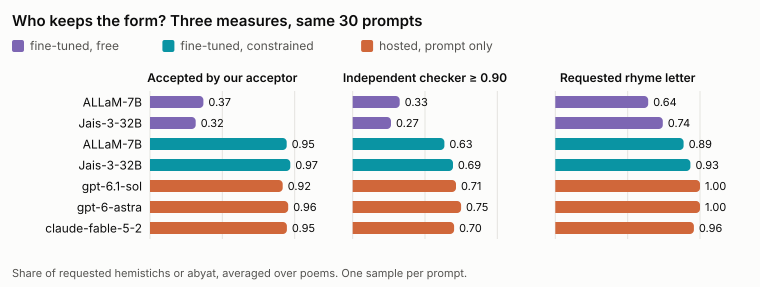
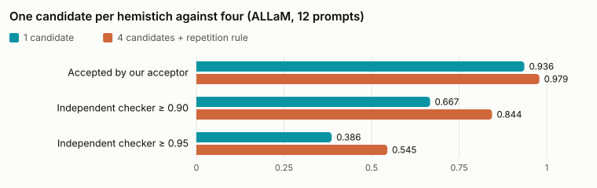
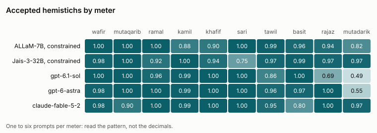
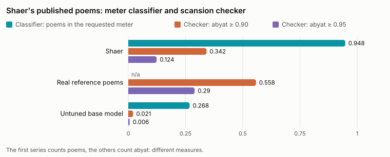
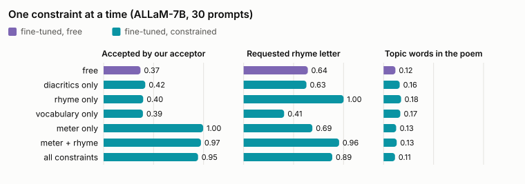
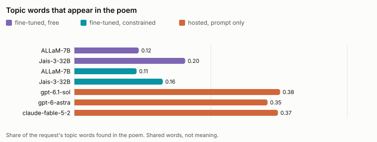
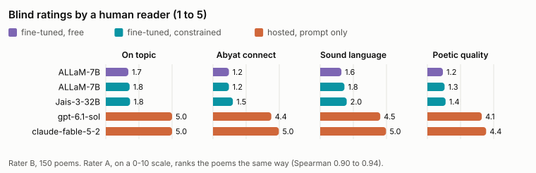
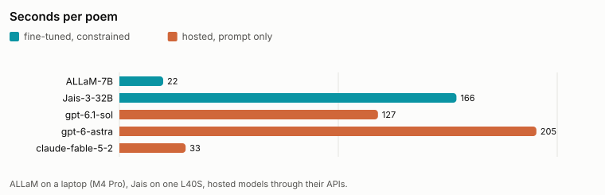

# Form Without Meaning: What a Hard Meter Constraint Guarantees, What It Cannot, and the Gap Between Acceptance and Quality in Arabic Poetry Generation

Kareem Adel

Technical report, 13 November 2026. Arabic version: [PAPER.ar.md](PAPER.ar.md). Plain-language
summary in Arabic: [SUMMARY.ar.md](SUMMARY.ar.md).


*الحمد لله الذي علّم بالقلم، علّم الإنسان ما لم يعلم.*
Praise be to God, who taught by the pen, taught man what he did not know.

## Abstract

What does a hard metrical constraint guarantee in generated verse, and what does it leave
untouched? We fine-tune two models (ALLaM-7B and Jais-3-32B) to write fully diacritized
classical Arabic verse and decode them under a filter that rejects, at every step, candidate
tokens that would break the requested meter, the rhyme letter or a corpus vocabulary. On 30
prompts over 10 meters we find three things.

**The constraint guarantees what is written into it, and no more.** Switched on one at a time,
each constraint moves its own measure and little else: the meter filter takes the share of
hemistichs our acceptor accepts from 0.37 to above 0.95, the rhyme check fixes the rhyme
letter, the vocabulary removes unattested words.

**It does not reach what readers judge.** Two human readers who did not know which system
wrote which poem rate the constrained model as they rate the free one on topic, connection
between abyat and language (on topic: 1.8 against 1.7 of 5), and a lexical measure of topic
words agrees. A model about five times larger shows the same pattern. We find no evidence
that the filter changes topic adherence in either direction; we do not identify its cause.

**Acceptance by a checker is not quality, and may not even be meter.** The acceptor accepts
0.95 of the constrained model's hemistichs; the same readers give those poems 2.5 of 10 and
2.8 of 5 for meter. In the published generations of an earlier system, Shaer, 94.8% of poems
are in the requested meter by its classifier while 34.2% of their abyat pass a scansion
checker at 0.90, a threshold that only 55.8% of abyat in real poems pass.

Three hosted general-purpose models given only the prompt (gpt-6.1-sol, gpt-6-astra,
claude-fable-5-2) fall in the same range as the constrained 7B model on the acceptor (0.92 to
0.96; no difference is clear of zero) and far above it for the readers (on topic: 5.0 of 5).
Parity on an acceptor is therefore not parity in quality, and we do not claim it.

Limits: the readers are not specialists and no prosodist has audited the acceptor; 30 prompts,
three seeds for the 7B model and one sample for the others; the hosted models are closed and
were queried on one day.

## 1. Introduction

Classical Arabic meter is based on syllable quantity. A line (bayt) has two hemistichs (sadr and 'ajuz), each
following one of the patterns of its meter (bahr), and a poem keeps one rhyme letter (rawi).
Whether a hemistich scans depends on short vowels that ordinary Arabic spelling does not write.
Checking undiacritized output automatically therefore requires restoring the vowels first,
which adds a second source of error.

Our earlier experiments in this project fine-tuned ALLaM-7B on public-domain poems. Fine-tuning
taught layout, length and rhyme, and raised the share of metrical abyat, but most abyat still
failed strict scansion. This report examines the next step: requiring the model to generate full
diacritics, and constraining generation to patterns accepted for the requested meter.

Contributions:

1. An analysis of what a hard constraint guarantees and what it cannot: an ablation that
   switches the meter, rhyme, vocabulary and diacritic constraints on one at a time, with
   blind human ratings and a lexical topic measure (Sections 4.9 and 4.10).
2. Evidence of a gap between acceptance by a checker and the quality of the text, at three
   levels: acceptor against readers, classifier against scansion, and scansion checker against
   real verse (Sections 4.8 and 4.10).
3. A catalogue of how a model satisfies a hard filter without writing verse (Section 4.4).
4. The tools: an 'arud acceptor over diacritized text and a constrained decoder for MLX and
   PyTorch (Section 3), and a comparison on the same prompts of two fine-tuned models and three
   hosted models given only the prompt (Sections 4.1 to 4.7).

## 2. Related work

**Arabic poetry generation.** Shaer (Abbas et al., ArabicNLP 2026) fine-tunes Yehia-7B on 116k
poems with meter, subform and description conditioning, and reports 95.2% base-meter accuracy
measured by a learned classifier; rhyme is neither controlled nor evaluated. Sadallah et al.
(arXiv 2604.27766) report human ratings of LoRA-tuned models; tuned ALLaM-7B scores 3.99/5
overall. The Fanar-Diwan model card reports, from two linguists on 50 poems and a 0 to 10
scale, fluency 6.88 but meaning 4.83 against GPT-4o's 6.25 and 5.52: a form-specialised model that wins on fluency and
loses on meaning, which is the pattern we see.

**Meter-constrained decoding.** Hafez (Ghazvininejad et al., 2016) uses a finite-state acceptor
for English. Chandomitra (arXiv 2506.00815) filters tokens with syllable-weight patterns for
Sanskrit and reports 99.86% metrical output with human coherence 2.1 against 3.8 for the
unconstrained model. For Arabic, the systematic review of Alkhalaileh and AlMazaedh (2026; 45 studies, 2020 to
2025) reports that hybrid systems which "attempt to enforce meter and rhyme during decoding"
exist and give the most stable meter and rhyme, and it names OKAZ (Refaee, 2023) and
Al-Najjar (2023) among constraint-aware approaches. We checked both as far as we could. The
abstract of OKAZ describes a comparison of deep-learning generators in which fine-tuned GPT-2
was best (BLEU 0.082; 2.94 of 5 from human experts against 4.62 for human poems) and mentions
no constraint on decoding; its full text is behind a paywall and we have not read it. The
abstract of Al-Najjar describes a stylistic study that asks an AI system for poems and checks
them against the rules of prosody and grammar afterwards, concluding that it could not
produce metrically sound Arabic verse; it is not a decoding method. So we found no Arabic
system that filters tokens by meter during decoding, but the review's wording and the unread
full text of OKAZ leave room for one, and we do not claim to be first. The review's main finding
matches ours: structural tasks are far ahead of meaning, generated poems are formally
acceptable and semantically shallow, and larger models do not by themselves close the gap. It
also separates cohesion (connected words) from coherence (a connected thought), which is the
distinction our reading turns on. It does not cover systems published in 2026, such as Shaer.

**Why masking hurts.** Park et al. (arXiv 2405.21047) show that constrained outputs are not
sampled in proportion to the model's own distribution. Loula et al. (arXiv 2504.13139) call
local masking myopic and improve on it with weighted particles. Ctrl-G (Zhang et al., arXiv
2406.13892) computes the probability that a constraint can still be met. For repair after
drafting, Deng et al. (arXiv 1911.13182) report human gains in fluency and meaning from masked
refilling of Chinese poems, with a loss in form accuracy when the form is not enforced during
refilling; Agirrezabal and Gonçalo Oliveira (ICCC 2025) find rule-based metrical feedback more
useful than model feedback.

## 3. Method

### 3.1 Data

The corpus is Arabic Wikisource poems by authors who died in or before 1975 (40,043 poems, 296
poets). We treat these works as public domain in Egypt, where the project is based; that is
not a claim about other jurisdictions, and Wikisource's CC BY-SA terms apply to the
transcriptions. `scripts/build_tashkeel_sft.py` diacritizes every hemistich with CATT, keeps the
source's own diacritics where present, and tests each bayt with pyarud against the poem's
meter. In the set used here (tashkeel-v2) a bayt passes if it scans exactly or scores at least 0.90.
If at least 70% of a poem's abyat pass, the whole poem is kept, failing abyat included (4,506
poems); otherwise only the passing abyat are kept, and the poem is dropped if fewer than 3
remain. Result: 9,492 training poems, 76,318 abyat, split by poem into train, validation
(1,117) and test (1,103). We did not check author or near-duplicate overlap between splits.
Each example is a request (topic, meter, rawi, number of abyat, mood) and the diacritized
poem, one hemistich per line. Topic and mood labels were written by a language model from the
poem and were not verified by hand. Weak labels are one possible cause of the weak topic
adherence we report.

A defect found late: 8% of training hemistichs carry a doubled tanween (`ًاً`) left by the
diacritizer, and both models learned to write it.

### 3.2 Models

| | ALLaM-7B-Instruct | Jais-3-32B |
|---|---|---|
| Method | QLoRA 4-bit, LoRA rank 16, 1 epoch | QLoRA 4-bit NF4, LoRA rank 16, alpha 32, all attention and MLP projections, 137 M trainable parameters, LR 1e-4, effective batch 8, max 1,200 tokens, 1 epoch (1,187 steps) |
| Hardware | Kaggle T4 x2, 4.41 h | one L40S (SageMaker ml.g6e.4xlarge), 4.49 h training |
| Validation loss | 2.015 to 1.908 | 1.665 (step 200) to 1.605 |
| Test loss | not measured on this split | 1.594 |

Exact settings are in `kaggle/allam_tashkeel_v2.ipynb` and `cloud/sagemaker/train_sft.py`.
The losses are computed with different tokenizers and are not directly comparable.

### 3.3 Constrained decoder

The decoder controls the layout (sadr, newline, 'ajuz, blank line); the model only chooses
words. This is filtering of a candidate list, not a mask over the whole vocabulary: at each
step the decoder takes the 40 most probable tokens (the top 400 if none of the 40 survives),
drops the candidates listed below, and samples among the survivors according to their renormalized
probability at temperature 0.7. A hemistich is limited to 70 tokens. The decoder drops any
candidate that:

- makes the diacritized text ill-formed (a mark with no letter, two vowel marks on one letter,
  shadda with sukun, a tanween inside a word, a word opening with a doubled or quiescent letter);
- makes the pattern of moving and quiescent letters of the settled text stop being a prefix of
  a legal hemistich pattern of the meter (patterns, zihafat and 'ilal from pyarud's tables);
- finishes a word that is not in the corpus vocabulary (73,278 forms seen at least twice, with
  or without one proclitic), or starts one that cannot become such a word.

A hemistich ends when the model chooses a newline and the text is a complete legal hemistich.
An 'ajuz must also end in the requested rawi, followed by at most one wasl letter or a ha'
with its khuruj, with a rhyme word not used earlier in the poem. This is an orthographic
approximation of the rawi, not a full analysis of the qafiya. On a dead end (no candidate
survives, or the token limit is reached) the hemistich is sampled again from its start,
up to 6 times; a hemistich that still fails is recorded as "…" and counted as a failure. The
KV cache is snapshotted per hemistich (copied on MLX, cropped on PyTorch).

### 3.4 Measures

- **Exact** (acceptance by our acceptor): share of requested hemistichs that the final
  acceptor reads, from the system's own diacritics, as a complete legal hemistich of the
  requested meter. It trusts those diacritics, and for the constrained rows it is measured with
  the rules that guided decoding, so it is not an independent test of correctness.
- **Checker ≥ 0.90 / ≥ 0.95**: strip the diacritics, re-diacritize with CATT, score the bayt
  with pyarud against the requested meter. This procedure does not use the system's diacritics, but it is not an independent validation of metrical correctness. The score
  is pyarud's own score for the bayt under the forced meter, used as given. Earlier
  calibration in this project: at 0.90 it accepted 63% of real abyat and none of 20
  non-metrical lines; it also accepts 20 to 28% of abyat with one word removed or replaced.
- **Rawi**: share of requested abyat whose last word ends in the requested letter, then at most
  one wasl letter or ha' with its khuruj.
- **Unfinished**: hemistichs written as "…", per poem.
- **Verbatim**: hemistichs whose undiacritized text occurs in the corpus (338,406 hemistichs).

Benchmark: the 30 prompts of our 44-prompt set that name a meter; 10 meters, 188 requested
abyat, 24 prompts with a rawi; one sample per prompt, seed 0.

Aggregation: every measure is computed per poem over the abyat or hemistichs the prompt
requested (a missing or unfinished one counts as a failure) and then averaged over poems, so
short and long poems weigh the same. Rawi is averaged over the 24 prompts that name one.
"Verbatim" is a pooled count over the hemistichs written.

## 4. Results

All figures in the table are recomputed from the saved poems by `scripts/paper_tables.py`
(`paper/results.json`).

| System (30 prompts) | Exact | Checker ≥ 0.90 | Checker ≥ 0.95 | Rawi | Unfinished per poem | Verbatim |
|---|---|---|---|---|---|---|
| ALLaM-7B fine-tuned, free | 0.369 | 0.325 | 0.125 | 0.642 | 0.00 | 0 / 376 |
| ALLaM-7B fine-tuned, constrained (first acceptor) | 0.861 | 0.620 | 0.405 | 0.931 | 0.50 | 0 / 361 |
| ALLaM-7B fine-tuned, constrained (final acceptor) | 0.945 | 0.634 | 0.391 | 0.887 | 0.67 | 0 / 356 |
| Jais-3-32B fine-tuned, free | 0.316 | 0.265 | 0.094 | 0.743 | 0.03 | 0 / 375 |
| Jais-3-32B fine-tuned, constrained (first acceptor) | 0.821 | 0.607 | 0.323 | 0.920 | 0.43 | 0 / 363 |
| Jais-3-32B fine-tuned, constrained (final acceptor) | 0.970 | 0.693 | 0.369 | 0.934 | 0.37 | 0 / 365 |
| gpt-6.1-sol, prompt only | 0.917 | 0.714 | 0.406 | 1.000 | 0.00 | 0 / 376 |
| gpt-6-astra, prompt only | 0.955 | 0.749 | 0.407 | 1.000 | 0.00 | 0 / 376 |
| claude-fable-5-2, prompt only | 0.946 | 0.701 | 0.460 | 0.958 | 0.00 | 0 / 368 |

"First acceptor" rows were decoded before the diacritic well-formedness rules of Section 3.3
were tightened. Under the acceptor in force at the time they scored 0.961 and 0.960; the final
acceptor rejects 10 to 14 points of those hemistichs as ill-formed. We report the final
acceptor for every row so that one rule applies to all. Both models were then decoded again
under the final acceptor ("final acceptor" rows). The second Jais job also wrote the free
poems again: 0.323 accepted, 0.268 on the checker, 0.660 on the rhyme letter, close to the
first run shown in the table.

**Uncertainty.** 95% intervals from a bootstrap over the 30 prompts (10,000 resamples; all
values in `paper/results.json`). They describe variation across these prompts only, not across
seeds or other prompts.

| | Accepted by our acceptor | Checker ≥ 0.90 | Rhyme letter |
|---|---|---|---|
| ALLaM-7B, free | 0.369 [0.298, 0.437] | 0.325 [0.244, 0.411] | 0.642 [0.490, 0.790] |
| ALLaM-7B, constrained | 0.945 [0.903, 0.976] | 0.634 [0.550, 0.715] | 0.887 [0.783, 0.967] |
| gpt-6.1-sol | 0.917 [0.836, 0.982] | 0.714 [0.625, 0.801] | 1.000 |
| gpt-6-astra | 0.955 [0.891, 0.994] | 0.749 [0.661, 0.826] | 1.000 |
| claude-fable-5-2 | 0.946 [0.872, 0.988] | 0.701 [0.624, 0.772] | 0.958 [0.875, 1.000] |
| Difference: constrained minus free (ALLaM) | +0.576 [0.507, 0.645] | +0.309 [0.201, 0.413] | +0.245 [0.054, 0.425] |
| Difference: gpt-6.1-sol minus ALLaM constrained | -0.027 [-0.113, 0.047] | +0.080 [-0.025, 0.182] | +0.113 [0.033, 0.217] |
| Difference: claude-fable-5-2 minus ALLaM constrained | +0.001 [-0.090, 0.070] | +0.066 [-0.054, 0.180] | +0.071 [-0.059, 0.201] |
| Difference: claude-fable-5-2 minus gpt-6.1-sol | +0.028 [-0.076, 0.126] | -0.014 [-0.129, 0.099] | -0.042 [-0.125, 0.000] |

The effect of the constraint is clear of zero on all three measures. Between the constrained
7B model and either hosted model, no difference in acceptance or in the checker is clear of
zero; only gpt-6.1-sol's lead on the rhyme letter is.



### 4.1 The constraint raises acceptance of form

For ALLaM, exact hemistichs rise from 0.369 to 0.945 and the requested rawi from 0.642 to
0.887. The checker pass rate increases less, from 0.325 to 0.634: the model's diacritics are
sometimes not what a reader or a diacritizer would put on the same letters, so "exact" is
conditional on diacritics that may be wrong. No hemistich of any system occurs verbatim in the corpus.

### 4.2 No visible gain in meaning

This subsection reports the author's reading (Section 5); the blind ratings that test it are
in Section 4.10. In the constrained poems the lines
are made of real words in a classical register and rarely form statements about the topic.
In the elegy for a mother, ALLaM addresses the mother and then repeats one frame for eight
abyat, and Jais never mentions her. Restricting words to the corpus vocabulary did not change
this: in the earlier meter-only run of the same 30 prompts, 10.3% of words were outside the
corpus vocabulary; with the vocabulary acceptor none are, by construction, and, in the author's reading, the five poems
we compared showed no apparent improvement in topic adherence.

### 4.3 A larger model: sounder syntax, the topic still missing

Jais-3-32B has about five times the parameters of ALLaM-7B (34.9 billion). This is not a
controlled scaling study: the two models differ in family, tokenizer and training recipe.
With that limit: free, its acceptance is not higher (0.316 against 0.369). Under the final
acceptor it reaches 0.970 against 0.945, 0.693 against 0.634 on the checker and 0.934 against
0.887 on the rhyme letter, and leaves fewer hemistichs unfinished (0.37 against 0.67 per
poem); none of these differences is clear of zero across prompts (acceptance +0.025
[-0.016, 0.074], checker +0.058 [-0.065, 0.187]). It takes 166 seconds per poem on an L40S
against 21.5 on a laptop for the 7B model. Its topic-word share under the constraint is 0.162
[0.096, 0.231], against 0.114 for ALLaM and 0.35 to 0.38 for the hosted models, and lower than
its own free poems of the same job (-0.097 [-0.197, 0.000]). Our reading of its poems is the
same in kind: better syntax inside a hemistich, less repetition of one frame, and little
treatment of the topic.

A model with no training for the task did not work under the constraint: Qwen3-30B, on the 3
prompts tried, left a mean of 10 hemistichs per poem unfinished. The filter removes constraint-violating
continuations; it cannot ensure that the model proposes acceptable ones.

### 4.4 How a model satisfies a mask without writing verse


After each rule we added, we found another way in which the output passed the acceptor
without being sound verse. In order of discovery:

1. Non-words that fit the pattern. Closed by the vocabulary acceptor.
2. Fragments that count as words: a lone proclitic, a single letter. Closed.
3. Tatweel inside a word, which pads it without changing the scansion. Closed.
4. A space inside a word, so each half is a known word (`أَعْمُرَّ هَا`). Open.
5. Stacked or impossible diacritics (`وَدَّْاِّعِ`). Closed by the final acceptor, at a cost:
   unfinished hemistichs per poem rose from 0.50 to 0.67.
6. Case endings chosen for the scansion, not the syntax. Open; not measurable by our tools.
7. In short meters (ramal, mutadarik), words running across the hemistich boundary in most
   abyat, leaving fragments that are not words. Running a word across the boundary (tadwir) is
   legitimate but rare in real verse; this output is not readable. Open.
8. A rhyme letter buried under two suffix letters (`رَاعِيًا` accepted for a rawi of ع). Closed.
9. Idle rhyme words, chosen only for their last letter. Open.

Items 6 and 9 are not errors of form that our rules can see.

### 4.5 Choosing among several legal hemistichs

Following the analysis of masking as myopic, we let the decoder collect up to 4 distinct legal
hemistichs (within a budget of 9 attempts) and keep one (12 prompts, ALLaM). We tried two
scores, both means per token: the log of the model's total probability on the surviving
candidates at each step (how little the filter removed), and the log-probability the model
gave the tokens written. With either score alone the model repeated lines: one sadr appeared
8 times in an 8-bayt poem. The table uses the first score together with a rule that ranks a
candidate last when more than half of its words occur in one earlier hemistich. The run does
not separate the effect of the score from the effect of the rule.

| ALLaM, 12 prompts | 1 candidate | 4 candidates + repetition rule |
|---|---|---|
| Exact | 0.936 | 0.979 |
| Checker ≥ 0.90 | 0.667 | 0.844 |
| Checker ≥ 0.95 | 0.386 | 0.545 |
| Unfinished per poem | 0.67 | 0.17 |
| Seconds per poem (M4 Pro) | 23 | 56 |



Acceptance of form improves; in the three poems of this run that we read, topic adherence
did not. This run predates the
rawi fix of item 8, and with 12 prompts and one seed the size of the gain is uncertain.

### 4.6 Prompted plans were not followed by a model untrained on plans

The classical manuals describe composition as meaning first, with the rhyme word known before
the bayt is written (Ibn Tabataba; Ibn Rashiq). We put a plan in the prompt (per bayt: its
rhyme word and two content words, read off real test poems) and held each 'ajuz to its planned
rhyme word. On 8 short poems (3 to 6 abyat) the fine-tuned ALLaM, which had never seen a plan in
training, completed no 'ajuz at all: the decoder rejected every attempt because none ended on
the planned word, so every 'ajuz was written as "…" (4.1 per poem). None of the planned
content words appeared in the sadrs it did write. This is one model and 8 poems. The script that
builds a plan-conditioned training set (9,485 poems) is released; no model has been trained on
it, so whether training on plans helps is untested.

### 4.7 A hosted model with the prompt only

We sent the same 30 requests, with the same instruction to write full diacritics, to
the model id `gpt-6.1-sol` through the chat completions API with default settings, one sample
each, on 13 November 2026. Nothing was added to the prompt and nothing was filtered or
retried. The requests are built by `scripts/eval_api_direct.py`; the raw responses are in
`paper/data/direct_gpt61sol_scored.json`. This is an observational baseline: the system's
size, training data and inference budget are unknown, and it does not show that prompting
generally beats constrained decoding.

It reaches 0.917 exact hemistichs, 0.714 on the independent checker and 1.000 on the requested
rawi. By meter: 0.96 to 1.00 on basit, kamil, khafif, mutaqarib, ramal, sari' and wafir; 0.86
on tawil; 0.69 on rajaz; 0.49 on mutadarik. Two of its failures are endings our tables do not
list: a tawil poem rhymed on a quiescent consonant (`الدَّارْ`), and a mutadarik poem whose
lines all close on a quiescent consonant. We have not had a prosodist decide whether these are
licences or errors.

**A larger model from the same vendor.** `gpt-6-astra`, queried the same way on the same day:
0.955 accepted, 0.749 and 0.407 on the checker, 1.000 on the rhyme letter, no verbatim
hemistich, about 205 seconds per poem. Its difference from gpt-6.1-sol in acceptance is +0.038
[-0.007, 0.097]. Like gpt-6.1-sol it closes every line of the mutadarik poem on a quiescent
consonant, which our acceptor rejects (0.10 for that poem); two models making the same choice
suggests the gap may be in our tables.

**A second hosted model.** On the same day we sent the same 30 requests to `claude-fable-5-2`
through the Messages API, with default settings, one sample each, no fallback model, nothing
filtered or retried (`scripts/eval_claude_direct.py`; raw responses in
`paper/data/direct_claudefable52_scored.json`). The acceptor accepts 0.946 of its hemistichs,
the independent checker passes 0.701 of its abyat (0.460 at the stricter threshold), and 0.958
of abyat end on the requested rhyme letter. One poem was laid out with a blank line after
every hemistich instead of after every bayt, so our parser finds no bayt in it and it scores
zero as written; read in pairs it is fully accepted, which would put the model at 0.979 and
1.000. We report the figure as written. It took about 33 seconds per poem. The two hosted
models agree closely with each other, which makes the result less likely to be a property of
one vendor's model.



Its poems treat their topics (Section 5). Three caveats matter. The model is closed and may
change, so the figure is a dated observation. Our verbatim check covers our corpus only, not
Arabic poetry at large. And its register is modern and plain rather than classical.

### 4.8 Shaer's published poems under the scansion checker

Shaer's base model is gated and we could not run it. The authors publish the 3,481 test
generations behind their headline figures, with the reference poems and the untuned base
model's generations. We filtered to the subform "tam", drew 500 prompts at random (seed 0; 2,813
requested abyat), and scored them. The classifier row is the share of these 500 poems that the
authors' published labels mark as being in the requested meter; the paper's 95.2% is the same
measure on all 3,481.

| | Shaer | Real reference poems | Untuned Yehia |
|---|---|---|---|
| Paper's classifier: poem in the requested meter | 94.8% | n/a | 26.8% |
| Our checker: abyat ≥ 0.90 | 34.2% | 55.8% | 2.1% |
| Our checker: abyat ≥ 0.95 | 12.4% | 29.0% | 0.6% |
| Abyat ending in the poem's most common final letter | 76.2% | 94.5% | 61.6% |



The first row counts poems and the others count abyat, so the rows are different measures and
should not be interpreted as a decline in a single measure. What the table shows is that a high classifier accuracy can coexist
with a pass rate under the checker well below that of real verse (34.2% against 55.8%), so
classifier accuracy alone is not evidence that the verse scans. The checker itself is limited
in both directions: it rejects 44% of abyat in real poems here and accepts some damaged abyat
(Section 3.4). Its figures are checker pass rates, not estimates of the proportion of metrically correct verse. These prompts are not our
prompts, so this table is not a comparison between Shaer and the systems of Section 4.

### 4.9 One constraint at a time, and what was missing before any constraint

A reviewer's question: is the weak meaning caused by the meter filter, by the old vocabulary,
or by something that was there before any filter? We switched the constraints on one at a time
for the fine-tuned ALLaM on the same 30 prompts and seed, and added a measure that needs no
reader: the share of the request's topic words whose stem occurs in the poem. It sees shared
words, not meaning, and a poem can be on topic without repeating them.

| ALLaM-7B, seed 0 | Accepted | Checker ≥ 0.90 | Rhyme letter | Unfinished per poem | Topic words |
|---|---|---|---|---|---|
| Free | 0.369 | 0.325 | 0.642 | 0.00 | 0.118 |
| Well-formed diacritics only | 0.417 | 0.394 | 0.628 | 0.00 | 0.161 |
| Rhyme only | 0.396 | 0.401 | 1.000 | 0.00 | 0.175 |
| Vocabulary only | 0.393 | 0.386 | 0.405 | 0.00 | 0.167 |
| Meter only | 0.996 | 0.680 | 0.688 | 0.03 | 0.126 |
| Meter + rhyme | 0.974 | 0.635 | 0.955 | 0.33 | 0.131 |
| All constraints | 0.945 | 0.634 | 0.887 | 0.67 | 0.114 |



Each constraint moves its own measure and little else. Meter alone gives 0.996 accepted with
almost no unfinished hemistich; the unfinished hemistichs come from adding the rhyme (0.33 per
poem) and then the vocabulary (0.67). The topic-word share stays between 0.11 and 0.18 in every
row, the free one included.

Two more seeds for the free and fully constrained modes give the same picture: accepted 0.367
and 0.375 free, 0.935 and 0.945 constrained (seed 0: 0.369 and 0.945); topic words 0.212 and
0.186 free, 0.196 and 0.148 constrained.



Across systems the same measure separates two groups: 0.35 to 0.38 for the three hosted models
(intervals within 0.27 to 0.49) and 0.11 to 0.21 for the fine-tuned models, free or
constrained. So on this proxy the fine-tuned model was already off topic before any filter,
and filtering by meter, rhyme or vocabulary is not associated with any change in it. The blind ratings of Section 4.10 say the same.

### 4.10 Blind ratings by two human readers

Two human readers, neither a specialist in classical poetry or prosody, rated 150 poems: the
30 prompts for five systems (ALLaM free, ALLaM constrained, Jais constrained, gpt-6.1-sol,
claude-fable-5-2; gpt-6-astra was added after the sheet went out and is not rated). The sheet
gave each poem a code and its request, in shuffled order, with no system name. Rater B used the
sheet's 1 to 5 scale; rater A used 0 to 10, which we report as given. Scores without the
raters' notes are in `paper/data/human_ratings/`; `scripts/human_eval.py` computes the tables.

| | On topic | Abyat connect | Sound language | Poetic quality | Meter | Overall |
|---|---|---|---|---|---|---|
| **Rater A (0 to 10)** | | | | | | |
| ALLaM-7B, free | 2.5 | 1.5 | 1.3 | 1.3 | 2.4 | 1.8 |
| ALLaM-7B, constrained | 2.6 | 1.7 | 1.7 | 1.5 | 2.5 | 2.1 |
| Jais-3-32B, constrained | 3.0 | 2.0 | 1.8 | 1.8 | 2.9 | 2.4 |
| gpt-6.1-sol | 10.0 | 8.6 | 8.7 | 7.4 | 7.1 | 8.3 |
| claude-fable-5-2 | 9.9 | 8.9 | 8.7 | 7.5 | 7.5 | 8.4 |
| **Rater B (1 to 5)** | | | | | | |
| ALLaM-7B, free | 1.7 | 1.2 | 1.6 | 1.2 | 2.3 | 1.2 |
| ALLaM-7B, constrained | 1.8 | 1.2 | 1.8 | 1.3 | 2.8 | 1.2 |
| Jais-3-32B, constrained | 1.8 | 1.5 | 2.0 | 1.4 | 2.9 | 1.5 |
| gpt-6.1-sol | 5.0 | 4.4 | 4.5 | 4.1 | 4.9 | 4.2 |
| claude-fable-5-2 | 5.0 | 5.0 | 5.0 | 4.4 | 5.0 | 5.0 |



**Agreement.** Over the 150 poems the two raters' scores correlate at 0.90 to 0.94 (Spearman)
on every dimension. Most of that is the gap between the two groups of systems, which any
reader sees: within the 90 fine-tuned poems the correlation is 0.58 to 0.79, and within the 60
hosted poems 0.08 to 0.71. The raters agree on which poems are good and much less on how to
order the good ones.

**What the ratings show.**

- The hosted models are rated far above the fine-tuned models on topic, connection, language
  and quality by both raters; the difference between gpt-6.1-sol and constrained ALLaM is clear
  of zero on every dimension for both.
- The constraint does not change how on-topic or how connected the fine-tuned poems are rated.
  Constrained minus free, ALLaM, on topic: +0.03 of 10 for rater A and +0.10 of 5 for rater B,
  both intervals spanning zero; on connection, +0.2 and 0.0. This agrees with the lexical proxy
  of Section 4.9: we see no effect of the filter on topic adherence, in either direction.
- The raters do not hear the meter that the acceptor accepts. Constrained ALLaM, of whose
  hemistichs the acceptor accepts 0.945, is rated 2.5 of 10 and 2.8 of 5 on meter; the
  constraint raises rater B's meter score by 0.47 [0.23, 0.70] and rater A's not at all. Either
  the acceptor passes lines that do not sound metrical, or readers who are not prosodists
  judge meter through sense. We cannot tell which without a prosodist, and it is the strongest
  reason to have the acceptor audited.
- Between the two hosted models, rater B prefers claude-fable-5-2 overall (+0.80 of 5
  [0.63, 0.97]) and rater A sees no clear difference.

### 4.11 Before and after fine-tuning

To separate what the model lacked from what our training did to it, we ran the base
ALLaM-7B, with no adapter, on the same 30 prompts in free mode.

| ALLaM-7B, free | Accepted | Checker ≥ 0.90 | Rhyme letter | Topic words |
|---|---|---|---|---|
| Base model, no fine-tuning | 0.030 | 0.032 | 0.066 | 0.305 [0.194, 0.426] |
| Fine-tuned, seed 0 | 0.369 | 0.325 | 0.642 | 0.118 |
| Fine-tuned, seed 1 | 0.367 | 0.402 | 0.604 | 0.212 |
| Fine-tuned, seed 2 | 0.375 | 0.321 | 0.365 | 0.186 |

Fine-tuning is what gives the model any form at all: accepted hemistichs rise by 0.34
[0.27, 0.41]. On the lexical topic measure it moves the other way: the fine-tuned model uses
fewer of the request's topic words than the base model in all three seeds (differences -0.19
[-0.30, -0.08], -0.09 [-0.24, 0.05] and -0.12 [-0.25, 0.01]), clearly so in one. The base
model's figure, 0.31, is close to the hosted models' 0.35 to 0.38.

This is consistent with the training being where topic adherence was lost, as the topic labels
of the training set were written by a model and never checked. It is not a demonstration: the
measure is lexical, two of three intervals include zero, and the test that would settle it,
retraining on verified labels, has not been run.

### 4.12 Held-out prompts

Everything above was measured on the 30 prompts we also used while writing the acceptor's
rules. To check that the results are not fitted to them, we froze the rules (hash in
`paper/data/frozen_rules.txt`), wrote 30 new prompts with the same meters, rhyme coverage and
lengths and new topics (`data/benchmarks/poetry_prompts_v3_heldout.jsonl`), and ran every
system on them once.

| Held-out prompts | Accepted | Checker ≥ 0.90 | Checker ≥ 0.95 | Rhyme letter | Unfinished per poem | Topic words |
|---|---|---|---|---|---|---|
| ALLaM-7B, base, free | 0.035 | 0.022 | 0.000 | 0.078 | 0.67 | 0.282 |
| ALLaM-7B, fine-tuned, free | 0.384 | 0.364 | 0.129 | 0.592 | 0.00 | 0.164 |
| ALLaM-7B, fine-tuned, constrained | 0.975 | 0.619 | 0.374 | 0.946 | 0.30 | 0.214 |
| Jais-3-32B, fine-tuned, free | 0.316 | 0.251 | 0.107 | 0.648 | 0.03 | 0.158 |
| Jais-3-32B, fine-tuned, constrained | 0.959 | 0.681 | 0.361 | 0.922 | 0.50 | 0.173 |
| gpt-6.1-sol, prompt only | 0.891 | 0.644 | 0.417 | 1.000 | 0.00 | 0.409 |
| gpt-6-astra, prompt only | 0.941 | 0.739 | 0.454 | 1.000 | 0.00 | 0.425 |
| claude-fable-5-2, prompt only | 0.895 | 0.655 | 0.423 | 0.958 | 0.00 | 0.393 |

The pattern of the first set repeats.

- The constraint raises acceptance by 0.59 [0.52, 0.67] (first set: 0.58) and leaves the
  topic-word share where it was (+0.05 [-0.04, 0.14]).
- Fine-tuning raises acceptance by 0.35 [0.26, 0.44] over the base model and lowers the
  topic-word share by 0.12 [-0.24, 0.00], the direction seen on the first set.
- The hosted models use about twice the topic words of the constrained model (differences
  +0.18 to +0.21, all clear of zero) and are not above it on the checker (no difference clear
  of zero).
- On the acceptor the constrained 7B model is now slightly ahead of two hosted models (0.975
  against 0.891 and 0.895, differences clear of zero) and level with gpt-6-astra. For
  claude-fable-5-2 this is again mostly layout: two poems were written with a blank line after
  every hemistich and score zero as written; read in pairs both are fully accepted and its
  figure would be 0.962. The weak meters of the hosted models are the same as before
  (mutadarik and rajaz).
- Jais repeats it at five times the size: the constraint raises its acceptance by 0.64
  [0.58, 0.71] and leaves its topic-word share where it was (+0.02 [-0.09, 0.13]). Against the
  constrained 7B model no difference is clear of zero on any measure (acceptance -0.016
  [-0.035, 0.003], checker +0.062 [-0.044, 0.175], topic words -0.041 [-0.174, 0.094]). The
  hosted models use more than twice its topic words (+0.22 to +0.25, all clear of zero).
- No system reproduced a hemistich of the corpus.

The poems of this set have not been rated by readers.

## 5. Reading the poems

The author read all poems of the runs in Section 4. This is one reader, not blind to the
system, with no scores recorded for these runs; it is not an expert evaluation. Every poem behind every
table (270 for the nine rows of the main table, plus those of the held-out prompts, the ablation, the extra seeds
and the candidate-selection run) is in `paper/data/` so the reading can be checked.

**Elegy for a mother, kamil, rawi د.** ALLaM, constrained (first acceptor; the doubled tanween
in the second line is the defect of Section 3.1):

> يَا أُمُّ تَدْرِي بِالدُّمُوعِ فَأَنْتُمَا
> هَذِي الدُّمُوعُ وَكَيْفَ لَاً تَتَجَدَّدُ

The same frame is repeated for eight abyat with one word changed. Jais, constrained, same
prompt:

> وَبَدَا بِهِ أَثَرُ الصَّبَابَةِ وَالنَّدَى
> لَمَّا تَوَافَى الْعَاشِقَانِ بِمَوْعِدٍ

Fluent, metrical, and about lovers; the poem never mentions a mother. gpt-6.1-sol, prompt only:

> وَإِذَا أَتَى عِيدٌ تَلَفَّتَ خَاطِرِي
> وَبِغَيْرِ وَجْهِكِ تُظْلِمُ الْأَعْيَادُ

On the topic throughout, from longing to a closing prayer; its last bayt is syntactically
broken.

**The refugee and his tent, mutadarik.** Jais, constrained, produced text split across
hemistichs until unreadable. gpt-6.1-sol:

> طِفْلُهَا يَسْأَلُ الْجُوعَ عَنْ لُقْمَتَيْنْ
> ثُمَّ يُصْغِي لِصَمْتٍ بِكِيسِ الطَّحِينْ

A concrete image, and an ending our acceptor rejects (exact 0.10 for this poem).

### One prompt, five systems, in full

The prompt: the joy of Eid in the neighbourhood, ramal, rawi د, four abyat. Nothing is selected
or edited; "…" is a hemistich the decoder could not finish.

**ALLaM-7B, constrained (final acceptor)**

> حَيّ يَا طَيْفَ الْمُنَادَى  
> بِحَيَاةٍ لَكَ بَادِي
>
> هَذِهِ الْأَضْحَى وَخَيْرُ  
> نَعِمَ الْعِيدُ بِعَادٍ
>
> فِي قُصَيْدِي قَدْ أَبَيْتَ  
> لَسْتُ لِلْعِيدِ بِبَادٍ
>
> لَا وَأَنَّ الْحُجَرَ الْحُمْرَ قَدْ الْجَ  
> لَتُ بِالْأَعْظَمِ رَادِي

**Jais-3-32B, constrained (first acceptor)**

> وَأَبِي أَنْتُمْ أَرْ الَّذِي نَقَلُّْ  
> نَا كَمَا نَقْلٌ لَنَا فِي الْأَحْمَدِ
>
> بِكْرَةٍ تَجْرِي بِأَشْطَانِ الصَّوَا  
> نِغِ لَا بِالْعَقْلِ وَالشَّدِّ الْهَوَدِّ
>
> لَمْ تَذُقْ كَأْسًاً وَلَا تَرَكَتْ الْعَا  
> قِلَ فِي حُكْمِ الصَّبَاحِ الْأَسْعَدِ
>
> فَلِذَاكَ سُمِّيَتْ مَوْلَاكُمْ الْأَرْ  
> وَعَ مِنْ دَاوُدَ أَوْ مِنْ يَحْيَى ابَدِّْ

**gpt-6.1-sol, prompt only**

> أَشْرَقَ الْعِيدُ فَغَنَّتْ دَارُنَا  
> وَتَلَاقَى الْجَارُ بِالْجَارِ السَّعِيدِ
>
> وَجَرَى الْأَطْفَالُ فِي سَاحَاتِنَا  
> يَمْلَؤُونَ الْحَيَّ بِاللَّحْنِ الْفَرِيدِ
>
> وَتَقَاسَمْنَا رَغِيفًا طَيِّبًا  
> وَكَسَوْنَا كُلَّ طِفْلٍ بِالْجَدِيدِ
>
> صَارَ كُلُّ الْحَيِّ بَيْتًا وَاحِدًا  
> وَتَغَنَّى كُلُّ بَابٍ بِالنَّشِيدِ

**gpt-6-astra, prompt only**

> أَشْرَقَ الْعِيدُ وَحَيِّي بَاسِمٌ  
> وَتَلَاقَى الْأَهْلُ فِي ظِلِّ الْوِدَادِ
>
> يَرْكُضُ الْأَطْفَالُ فِي سَاحَاتِنَا  
> كَالْفَرَاشِ الْحُرِّ فِي خُضْرِ الْوِهَادِ
>
> وَأَكُفٌّ تَحْمِلُ الْحَلْوَى لَنَا  
> وَشَذَى الْكَعْكِ نَشِيدٌ لِلْفُؤَادِ
>
> وَتَصَافَحْنَا عَلَى عَهْدِ الصَّفَا  
> وَجَمَعْنَا الشَّمْلَ مِنْ بَعْدِ الْبِعَادِ

**claude-fable-5-2, prompt only**

> أَشْرَقَ الْعِيدُ عَلَى أَبْوَابِنَا  
> فَالْأَمَانِي فِي حِمَانَا تُولَدُ
>
> وَالصِّغَارُ الْغُرُّ فِي أَثْوَابِهِمْ  
> كَعَصَافِيرِ الضُّحَى إِذْ تُنْشِدُ
>
> وَالتَّهَانِي بَيْنَ جَارٍ وَأَخٍ  
> بَسْمَةٌ تَحْلُو وَقَلْبٌ يَسْعَدُ
>
> وَعَلَى الشُّرْفَاتِ ضَوْءٌ رَاقِصٌ  
> وَبِحَلْوَى الْعِيدِ طَابَ الْمَوْعِدُ

## 6. Discussion


**A constraint guarantees what is written into it.** The ablation is the cleanest result here:
meter, rhyme and vocabulary each move their own measure. Meter alone reaches 0.996 accepted
with almost nothing left unfinished; the unfinished hemistichs are the price of adding rhyme
and then vocabulary. A constraint is a specification, and the model meets it literally:
Section 4.4 lists nine ways it did so without writing sound verse. Every rule we wrote
concerns form. Some failures that remain are formal too (items 4 and 7); the rest are of sense.

**It does not reach what readers judge.** Neither the lexical measure nor the two readers see a
difference in topic adherence or connection between the free and the constrained model. The
project began from the assumption that a small model fails at poetry mainly because it cannot
keep the meter; holding the meter for it did not produce the poet. We do not know why the
fine-tuned models stay off topic. The filter shows no effect in either direction on what we
measured; the training (topic labels written by a model and never checked, a small set) is a
candidate that Section 4.11 gives some support and no proof; and the literature on token masking as myopic (Park et al.;
Loula et al.) describes effects our measures might not see.

**Acceptance is not quality.** Three gaps point the same way. Readers give 2.5 of 10 and 2.8 of
5 for meter to poems of which the acceptor accepts 0.95. A meter classifier labels 94.8% of
Shaer's poems correctly while a scansion checker passes 34.2% of their abyat. And that checker
passes only 55.8% of abyat in real poems, and 20 to 28% of abyat with a word damaged. We
cannot say from this which instrument is wrong in each case: our readers are not prosodists,
and our acceptor has not been audited. What follows is narrower and firmer: a number produced
by an automatic checker of Arabic meter is evidence about the checker until a prosodist has
validated it, ours included.

**What the comparison with hosted models does and does not show.** On our acceptor the
constrained 7B model and the three hosted models are in the same range (0.945 against 0.917,
0.955 and 0.946), and no difference between them is clear of zero. That is a statement about
the acceptor. The readers place the hosted models far higher on every dimension, meter
included, so we do not describe the systems as equal. What can be said plainly is practical:
the constrained model is open, runs offline on a laptop in about 22 seconds per poem (the
hosted models took about 33, 127 and 205 through their APIs), and marks every hemistich it
could not finish.



**A hypothesis: the checker as a verifier.** A model that already writes mostly accepted,
on-topic verse fails in a few identifiable places per poem. An acceptor names the hemistich and
the reason. Sending that back for repair is the next system to test; we have not built or
measured it, and the gap described above limits it until the acceptor is audited.

## 7. Limitations

- The blind ratings come from two readers who are not specialists in classical poetry or
  prosody, one of whom used a different scale from the sheet; gpt-6-astra and the ablation
  poems are not rated. No expert has judged the poems. The comments in Section 5 are the
  author's reading, by a reader who knew which system wrote each poem.
- 30 prompts; three seeds for ALLaM free and constrained, one sample per prompt for every
  other system; the candidate-selection result uses 12 prompts
  and the plan test 8. The intervals in Section 4 come from a bootstrap over prompts and say
  nothing about seed variance or about prompts outside this set.
- Three hosted models from two vendors, each queried once on one day, through APIs whose
  underlying models may change.
- "Exact" is acceptance by our own acceptor and trusts each system's diacritics. The checker
  passes 55.8% of abyat in real poems and 20 to 28% of abyat with one word damaged.
- The fine-tuned models and the hosted model are not matched in size, training or budget.
- The acceptor's tables come from pyarud and have not been audited by a prosodist. During this
  work we found and fixed two errors (words with an unwritten long alif such as `إله`; the
  rawi rule) and identified endings it may wrongly reject.
- The Jais poems shown to the readers (Section 4.10) and quoted in Section 5 are those of the
  first acceptor; its poems under the final acceptor were scored automatically only.
- The verbatim check is against our own corpus.
- Of the two constraint-aware Arabic works named by the 2026 review we read only the abstracts
  (OKAZ; Al-Najjar 2023). Neither abstract describes a constraint during decoding, but we have
  not read the full text of OKAZ. We claim no priority.
- Training data are classical and public-domain; nothing here covers free verse or dialect.

## 8. Reproducibility

Code, poems and scores are at <https://github.com/Kareem-3del/arabic-poet> under Apache-2.0; `uv.lock` pins the environment. File hashes of the
training sets, benchmark and adapter, the versions of every model and tool, and what a rerun
can and cannot reproduce are in [REPRODUCIBILITY.md](REPRODUCIBILITY.md). The commands:

```
uv sync                                              # environment from uv.lock
uv run python scripts/eval_constrained.py <adapter> <out.json> 30 free,lexicon   # local runs
uv run python scripts/rescore_constrained.py <in.json> <out.json>                 # checker columns
uv run python scripts/paper_tables.py                # every table, from paper/data
uv run python scripts/human_eval.py <rater_A.csv> <rater_B.csv>
uv run python scripts/paper_figures.py && uv run --with markdown python scripts/build_paper_pdf.py
```

Decoder settings for every constrained row: top 40 candidates (400 on a dead end), temperature
0.7, 70 tokens per hemistich, 6 retries, seed 0 unless a seed is named. Key files:

| What | Where |
|---|---|
| 'Arud acceptor | `src/arabic_poet/poetry/arud_fsa.py` |
| Vocabulary acceptor | `src/arabic_poet/poetry/lexicon.py` |
| Constrained decoder (MLX, PyTorch) | `src/arabic_poet/generation/constrained.py` |
| Training set builders | `scripts/build_tashkeel_sft.py`, `scripts/build_plan_sft.py` |
| Jais training and in-job evaluation | `cloud/sagemaker/` |
| Local evaluation | `scripts/eval_constrained.py`, `scripts/eval_planned.py` |
| Hosted-model baseline | `scripts/eval_api_direct.py` |
| Shaer rescoring | `scripts/eval_shaer_published.py` |
| Tables of this report | `scripts/paper_tables.py`, `paper/results.json` |
| Poems and per-poem scores | `paper/data/` |

Cost: the Jais job billed 6.83 hours of server time on ml.g6e.4xlarge, about 26 USD. That is
the whole job: 4.49 hours of training, plus loading the model, writing samples and decoding the
30 prompts in both modes inside the same job. Decoding Jais again under the final acceptor, on
both prompt sets, billed 3.77 hours, about 14 USD. The hosted runs used about 180 thousand tokens
(gpt-6.1-sol), 184 thousand (gpt-6-astra, not counting requests that were dropped and repeated)
and 127 thousand (claude-fable-5-2, about 4.3 USD); everything else ran on a laptop (M4 Pro, 48 GB) or a free Kaggle GPU.

The corpus text and model weights are not in the repository. The corpus is rebuilt from Arabic
Wikisource by the scripts in `src/arabic_poet/data/`; Wikisource changes, so a rebuild will
not reproduce our corpus exactly, and we do not release a snapshot or the adapters here; the training poems carry Wikisource's
CC BY-SA terms.

AI assistance: an AI coding assistant was used to write code, run experiments and draft this
report under the author's direction. The author is responsible for its content. That assistant runs
on claude-fable-5-2, one of the three hosted models evaluated here. The evaluated poems were
produced by separate API calls that saw only the benchmark request, and they are scored by the
same programs as every other system; the reading of their meaning is the author's.

## References

- Abbas, Fakih, Fakih, Mohanna. Shaer: Controlled Arabic Poetry Generation with Meter Subform
  and Semantic Conditioning. ArabicNLP 2026, pp. 179-199.
- Agirrezabal, Gonçalo Oliveira. Refining Metrical Constraints in LLM-Generated Poetry with
  Feedback. ICCC 2025.
- Alkhalaileh, AlMazaedh. Systematic review, Cogent Arts & Humanities, 2026.
  DOI 10.1080/23311983.2026.2703440.
- Refaee. OKAZ: A deep-learning-based system for automatic Arabic poem generation. ICCIT 2023.
  Abstract read; full text not read.
- Al-Najjar. Artificial intelligence and Arabic poetry composition in light of the rules of
  prosody and grammar. Arts for Linguistic and Literary Studies 5(3), 2023.
  DOI 10.53286/arts.v5i3.1560. Abstract read.
- Chandomitra. arXiv 2506.00815.
- Deng et al. An Iterative Polishing Framework based on Quality Aware Masked Language Model for
  Chinese Poetry Generation. AAAI 2020. arXiv 1911.13182.
- Fanar-2-Diwan model card, huggingface.co/QCRI/Fanar-2-Diwan.
- Ghazvininejad, Shi, Choi, Knight. Generating Topical Poetry. EMNLP 2016.
- Loula et al. Syntactic and Semantic Control of Large Language Models via Sequential Monte
  Carlo. arXiv 2504.13139.
- Park et al. Grammar-Aligned Decoding. NeurIPS 2024. arXiv 2405.21047.
- Sadallah et al. Instruction-Guided Poetry Generation in Arabic and Its Dialects. arXiv
  2604.27766.
- Zhang et al. Ctrl-G. arXiv 2406.13892.
- Ibn Tabataba, 'Iyar al-Shi'r; Ibn Rashiq, al-'Umda (read on shamela.ws).
- Software: ALLaM-7B-Instruct-preview; inception42/Jais-3-32B (revision c87efc1f); CATT
  diacritizer; pyarud 1.0.0; MLX-LM; PEFT.
